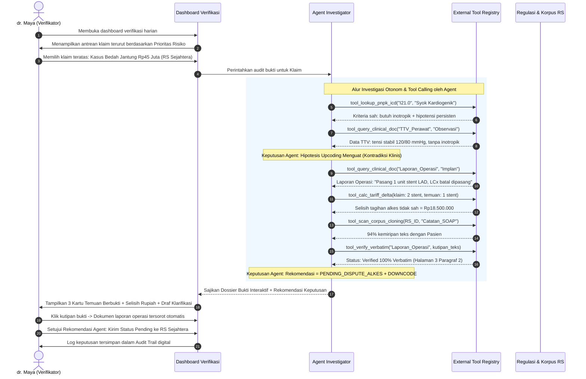

# 2 — Concept Brief

**Tema:** Detect Smarter, Protect JKN  
**Kategori:** Efisiensi Risiko Fasilitas Kesehatan (Kategori 3.1)  
**Sub-kategori Fokus:** Upcoding & Unbundling serta Inflated Bills & Cloning  
**Gate:** Seluruh anggota tim sepakat dan mampu menjelaskan produk dalam satu kalimat yang sama.

---

## 1. Problem Statement

Verifikator klaim BPJS Kesehatan di kantor cabang harus memeriksa ratusan berkas klaim rumah sakit per hari dengan alokasi waktu hanya hitungan menit per berkas. Sistem analitik yang ada saat ini (seperti DEFRADA) hanya mendeteksi anomali angka tabular dan menghasilkan skor risiko tanpa penjelasan klinis.

Akibatnya, dua modus manipulasi klaim terbesar yang tersembunyi di dalam narasi teks rekam medis kerap lolos dari pengawasan:
1. **Upcoding & Unbundling:** Menaikkan kode diagnosis/prosedur ke kelompok tarif INA-CBG yang lebih mahal tanpa dukungan bukti klinis (lab/radiologi), atau memecah satu paket tindakan menjadi beberapa episode klaim.
2. **Inflated Bills & Cloning:** Menagihkan jumlah alkes/implan dan obat khusus melebihi yang tercatat di laporan operasi riil (*inflated bills*), serta menyalin (*copy-paste*) catatan medis pasien lain untuk memalsukan kelengkapan berkas (*note cloning*).

Verifikator mengalami kelelahan kognitif, pemeriksaan menjadi tidak konsisten, dan klaim bermasalah baru disadari berbulan-bulan kemudian saat audit pasca-bayar KPK/BPKP.

---

## 2. Persona / Target User Utama

### Persona Utama: dr. Maya (34 Tahun) — Dokter Verifikator BPJS Kantor Cabang
- **Karakteristik & Beban Kerja:** 
  - Memiliki latar belakang medis umum, bertanggung jawab memverifikasi 150–250 berkas klaim rawat inap dan bedah per hari dari 4 rumah sakit mitra.
  - Alokasi waktu rata-rata: hanya 2–3 menit per berkas klaim untuk membaca PDF resume medis, laporan operasi, hasil lab, dan daftar tagihan farmasi/alkes.
- **Tantangan Harian (*Pains*):**
  - Matanya lelah membolak-balik lembaran PDF tebal untuk mencari apakah ada bukti lab penunjang diagnosis komplikasi yang diklaim RS.
  - Sering ragu apakah alkes implan (misal stent atau plat ortopedi) yang ditagihkan di kuitansi benar-benar dipasang di meja operasi sesuai narasi laporan bedah.
  - Khawatir jika menolak (*pending*) klaim tanpa dasar pasal/bukti kuat akan memicu sengketa sengit (*dispute*) dengan dokter penanggung jawab (DPJP) dan tim Casemix RS.
- **Kebutuhan (*Gains*):**
  - Antrean klaim yang sudah terurut berdasarkan prioritas risiko klinis.
  - Rangkuman temuan instan yang langsung menunjuk ke kutipan kalimat di dokumen rekam medis (*verbatim evidence*) dan pasal regulasi koding/tarif yang relevan.

### Persona Sekunder: Tim Anti-Fraud / PK-JKN & Auditor Medis
- **Kebutuhan:** Memerlukan *audit trail* digital yang merekonstruksi pola pelanggaran (misalnya mendeteksi jika ada 20 klaim di satu RS menggunakan teks resume medis yang identik/*cloning*), sehingga siap dijadikan berkas pembuktian audit formal.

> **Batasan Tegas:** Solusi ini secara sengaja **tidak ditujukan** untuk tim koder/Casemix rumah sakit pada versi MVP ini, demi menghindari konflik kepentingan dan menjaga ketajaman fokus pada sisi pengawasan dana JKN.

---

## 3. Value Proposition

### Satu Kalimat Nilai Utama:
> **"Mengubah tumpukan berkas klaim rumah sakit menjadi antrean audit prioritas yang dilengkapi Dossier Bukti Klinis otomatis—sehingga verifikator dapat mendeteksi indikasi upcoding, duplikasi catatan, dan penggelembungan alkes 5x lebih cepat dengan dasar pembuktian yang transparan."**

### Pemetaan Nilai (*Value Matrix*):
| Pihak Penerima Nilai | Manfaat Konkret |
|---|---|
| **Verifikator BPJS** | Hemat waktu per berkas; tidak perlu membaca manual ratusan halaman; memiliki dasar argumen kuat berbasis regulasi koding saat mengonfirmasi klaim ke RS. |
| **Tim Anti-Fraud / Auditor** | Memiliki berkas dossier terstruktur (*ready-to-escalate*) lengkap dengan perbandingan teks cloning antar-pasien dan jejak audit digital. |
| **BPJS Kesehatan (Institusi)** | Pengendalian potensi klaim anomali dilakukan pada fase **pra-bayar** (sebelum dana keluar), memangkas angka sengketa (*dispute*), dan menyamakan standar mutu verifikasi antar-kantor cabang. |
| **Faskes Berintegritas** | Terlindungi dari salah tuduh karena sistem menggunakan bahasa netral (*"indikasi ketidaksesuaian untuk ditinjau"*) dan menyertakan penjelasan alternatif bila ada data pendukung yang belum lengkap. |

---

## 4. Solusi yang Dipilih dan Alternatif yang Ditolak

### 4.1 Solusi yang Dipilih: *Agentic Clinical Evidence Investigator*
Arsitektur AI berbasis Agent yang bertindak sebagai "Asisten Investigator Bukti" bagi verifikator. Agent tidak bekerja sebagai kotak hitam statis (bukan sekadar prompt sekali jalan), melainkan **menjalankan penyelidikan otonom multi-langkah** melalui dua pilar utama:

#### A. Instrumen Investigasi Otonom (*Autonomous Tool Calling*)
Agent secara mandiri memanggil seperangkat instrumen eksternal (*tools*) untuk membuktikan atau menggugurkan hipotesis kecurangan klinis:
- **Tool Regulasi Medis & Koding:** Mengecek kriteria keparahan (*severity criteria*) dan batas pembiayaan resmi Kemenkes (ICD-10, ICD-9-CM, PNPK).
- **Tool Pengekstraksi Dokumen Klinis:** Menelusuri lembar spesifik rekam medis (laporan operasi, lembar observasi keperawatan, hasil lab/radiologi) sesuai indikasi kasus.
- **Tool Kalkulator Selisih Tarif:** Menghitung dampak rupiah antara tarif INA-CBG yang diklaim faskes vs tarif yang sah berdasarkan bukti klinis riil (Permenkes 3/2023).
- **Tool Pemindai Integritas Korpus:** Memindai rekam medis pasien lain di rumah sakit yang sama untuk mengukur tingkat kesamaan semantik teks (*semantic similarity*) guna mendeteksi penjiplakan catatan (*note cloning*).
- **Tool Verifikasi Verbatim (Anti-Halusinasi):** Menguji bahwa setiap kutipan bukti yang diambil 100% eksis secara harfiah pada dokumen sumber sebelum dimasukkan ke dalam dossier.

#### B. Keputusan Penyelidikan Otonom (*Autonomous Investigative Decisions*)
Sebelum dossier disajikan ke meja manusia, Agent membuat serangkaian keputusan penyelidikan:
1. **Keputusan Alur Penyelidikan (*Dynamic Routing*):** Memutuskan dokumen mana yang harus dibuka berikutnya. *Contoh:* Jika ada klaim implan ortopedi/kardiovaskular mahal, Agent otomatis memutuskan beralih dari resume medis ke laporan tindakan operasi dan rincian kuitansi alkes.
2. **Keputusan Penilaian Bobot Bukti (*Evidence Weighing*):** Menilai apakah bukti klinis berstatus *Mendukung (Supported)*, *Kurang Bukti (Incomplete)*, atau *Bertentangan (Contradictory)*.
3. **Keputusan Klasifikasi Diskrepansi:** Membedakan antara kesalahan administrasi koding murni (*unintentional clerical error*) dan pola manipulasi berulang (*systemic upcoding/cloning*).
4. **Keputusan Rekomendasi Aksi (*Action Recommendation*):** Merumuskan rekomendasi operasional bagi verifikator:
   - `REKOMENDASI: SETUJUI (FAST-TRACK)` — jika semua kriteria klinis terbukti valid.
   - `REKOMENDASI: PENDING KLARIFIKASI` — jika bukti pendukung belum terunggah, lengkap dengan draf surat permintaan ke RS.
   - `REKOMENDASI: PENURUNAN KODE (DOWNCODE)` — jika tindakan terbukti tidak memenuhi kriteria keparahan komplikasi yang diklaim.
   - `REKOMENDASI: ESKALASI AUDIT INVESTIGATIF` — jika terdeteksi duplikasi catatan massal lintas pasien di RS tersebut.

> **Prinsip Human-in-the-Loop:** Agent memutuskan *rekomendasi dan strategi investigasi*, sedangkan hak eksekusi persetujuan/penolakan transfer dana klaim tetap 100% di tangan verifikator manusia (dr. Maya).

---

### 4.2 Alternatif yang Ditolak & Rationale

| Solusi Alternatif | Alasan Ditolak |
|---|---|
| **Model Skoring Tabular Saja (seperti Machine Learning DEFRADA saat ini)** | **Ditolak.** Hanya menghasilkan angka probabilitas tanpa penjelasan. Tetap memaksa manusia membaca seluruh dokumen rekam medis secara manual untuk mencari bukti. |
| **Single-Prompt LLM Wrapper ("Beri saya teks klaim, apakah ini fraud?")** | **Ditolak.** Sangat rawan halusinasi (*AI hallucination*), tidak memiliki auditabilitas, latensi tidak terkontrol, dan mudah dinilai juri sebagai pemanfaatan AI yang dangkal (*AI as a gimmick*). |
| **Otomatisasi Penuh Pemotong Klaim (*Auto-Reject / Auto-Claim Denial*)** | **Ditolak.** Berbahaya secara etika dan regulasi. Melanggar prinsip *Human-in-the-Loop* yang ditekankan dalam panduan hackathon, serta berisiko mencederai hubungan kemitraan dengan rumah sakit akibat *false positives*. |
| **Sistem Validasi Pra-Kirim di Sisi Rumah Sakit (Casemix Tools)** | **Ditolak.** Memecah fokus tim dan menimbulkan konflik kepentingan antara sudut pandang pembayar (BPJS) dan penyedia layanan (RS). |

---

## 5. Satu Skenario Penggunaan Utama

> **Konteks:** Simulasi pengujian menggunakan berkas rekam medis sintetis yang terstandar pada sesi verifikasi pagi hari.



### Langkah demi Langkah Skenario:
1. **Prioritas Antrean Cerdas:** dr. Maya membuka dashboard. Alih-alih antrean kronologis acak, klaim dengan anomali klinis tertinggi ditempatkan di posisi teratas.
2. **Pemicu Investigasi:** dr. Maya membuka klaim pasien bedah jantung/vaskular berbiaya Rp45 juta.
3. **Penyelidikan Otonom oleh Agent (Di Balik Layar):**
   - Agent mengecek kriteria regulasi Kemenkes (`tool_lookup_pnpk_icd`) dan mendapati klaim komplikasi syok kardiogenik bertentangan dengan tanda vital stabil di lembar keperawatan (`tool_query_clinical_doc`).
   - Agent memeriksa narasi laporan pembedahan dan menemukan hanya 1 stent yang dipasang, padahal kuitansi menagih 2 stent. Agent langsung memanggil `tool_calc_tariff_delta` untuk menghitung potensi kebocoran dana sebesar Rp18,5 juta.
   - Agent memindai korpus RS (`tool_scan_corpus_cloning`) dan menemukan indikasi penjiplakan teks SOAP sebesar 94%.
   - Agent memvalidasi kutipan teksnya sendiri via `tool_verify_verbatim` untuk mencegah halusinasi.
4. **Penyajian Dossier Bukti & Rekomendasi:** Agent menyajikan dossier lengkap dengan 3 kartu bukti, kalkulasi selisih biaya, dan rekomendasi aksi: `PENDING — Minta Klarifikasi Fisik Alkes & Downcode Komplikasi`.
5. **Verifikasi 1-Klik (*Verbatim Grounding*):** dr. Maya mengklik kutipan laporan bedah. Sistem membuka PDF laporan operasi dan menyorot baris kalimat asli yang dikutip.
6. **Keputusan Manusia Terjustifikasi:** dr. Maya menerima rekomendasi Agent dan menekan tombol *"Kirim Pending ke RS"*. Sistem otomatis melampirkan draf surat klarifikasi berdasar kutipan resmi tersebut ke tim Casemix RS.

---

## 6. Definisi Sukses dan Keunggulan Produk

### 6.1 Definisi Sukses (Diuji pada Dataset Kasus Sintetis Terstandar)
Pengujian purwarupa dilakukan secara jujur dan transparan menggunakan **30–50 kasus klaim sintetis** (kombinasi kasus wajar, salah koding murni, upcoding, inflated bills, dan cloning):

| Metrik Evaluasi | Target Minimum MVP | Cara Pengukuran |
|---|---|---|
| **Akurasi Deteksi Diskrepansi** | $\ge 85\%$ | Persentase anomali klinis terencana yang berhasil diidentifikasi oleh sistem. |
| **Keandalan Bukti (*Zero-Hallucination Citations*)** | $100\%$ | Setiap kutipan teks di dalam dossier terbukti eksis secara verbatim di dokumen sumber. |
| **Toleransi Kasus Normal (*False Positive Rate*)** | $\le 15\%$ | Sistem tidak menandai kasus salah koding ringan/tidak sengaja sebagai manipulasi berat. |
| **Efisiensi Waktu Telaah** | Pangkas $\ge 60\%$ durasi | Membandingkan waktu verifikator memeriksa berkas tebal secara manual vs menggunakan dossier bukti. |
| **Auditabilitas** | $100\%$ | Seluruh interaksi dan keputusan verifikator tercatat dalam log *audit trail* digital. |

---

### 6.2 Keunggulan Kompetitif (Pembeda dalam 30 Detik di Depan Juri)
1. **Dossier Bukti Tervalidasi, Bukan Skor Gelap:** Tidak sekadar memberi label merah, melainkan menyajikan bukti kalimat nyata dan regulasi hukum rujukan.
2. **Menembus Tembok Teks Klinis RME:** Mengatasi titik buta sistem BPJS saat ini dengan menghubungkan catatan naratif dokter/perawat langsung ke tagihan biaya.
3. **Deteksi Lintas Dimensi yang Terintegrasi:** Mampu menemukan indikasi *Upcoding*, *Inflated Bills*, dan *Note Cloning* dalam satu alur telaah berkas yang utuh.
4. **Desain Hibrida yang Efisien:** Menggunakan aturan deterministik untuk penyaringan cepat berbiaya murah, dan hanya memanfaatkan penalaran Agentic AI untuk analisis teks klinis kompleks.
5. **Kepatuhan Human-in-the-Loop & Etika:** Menggunakan bahasa non-tuduhan (*objective discrepancy*), menjaga posisi dokter/verifikator sebagai pengambil keputusan akhir, dan bebas risiko kebocoran data karena beroperasi pada arsitektur anonim/sintetis.

---

## 7. Gate Check Dokumen 2

> **Kriteria Gate:** Seluruh anggota tim sepakat dan mampu mengucapkan satu kalimat deskripsi produk berikut:

```
"Solusi kami adalah Asisten Investigator Bukti Klinis berbasis Agentic AI yang membantu 
verifikator BPJS mendeteksi indikasi upcoding, penggelembungan alkes, dan duplikasi rekam medis 
secara pra-bayar melalui dossier bukti transparan berbasis kutipan dokumen nyata."
```

- [ ] Pernyataan produk di atas disepakati oleh seluruh anggota tim?
- [ ] Batasan fitur dan persona utama (hanya verifikator BPJS, tidak melayani RS) disepakati?
- [ ] Logika pemisahan tugas (deterministik untuk aturan tarif, agent untuk teks rekam medis & bukti) disepakati?
