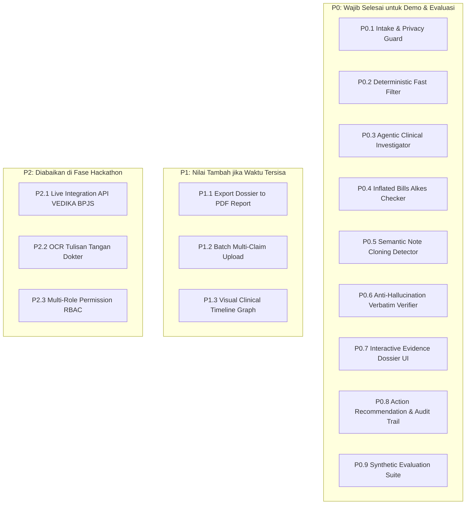

# 3 — Lean PRD (Product Requirements Document)

**Tema Hackathon:** Detect Smarter, Protect JKN  
**Kategori:** Efisiensi Risiko Fasilitas Kesehatan (Kategori 3.1)  
**Sub-kategori Fokus:** Upcoding & Unbundling serta Inflated Bills & Cloning  
**Dokumen Rujukan:** [`docs/hackathon-guideline.md`](file:///d:/Projects/Web%20Shi/healthkaton/docs/hackathon-guideline.md), [`docs/1-research-brief.md`](file:///d:/Projects/Web%20Shi/healthkaton/docs/1-research-brief.md), [`docs/2-concept-brief.md`](file:///d:/Projects/Web%20Shi/healthkaton/docs/2-concept-brief.md)  
**Gate:** Setiap fitur P0 memiliki perilaku yang jelas, terukur, dan dapat diverifikasi secara objektif.

---

## 1. Tujuan dan Non-Goals

### 1.1 Tujuan Produk (Goals)
1. Membangun purwarupa (**MVP**) asisten verifikasi klaim rumah sakit berbasis **Agentic AI** yang bertindak sebagai investigator bukti klinis pra-bayar bagi Verifikator BPJS Kesehatan.
2. Memproses berkas klaim digital (resume medis, laporan operasi, hasil lab, lembar billing farmasi/alkes) dan secara mandiri memanggil serangkaian *investigative tools* untuk mendeteksi:
   - **Upcoding:** Diagnosis/tindakan komplikasi tanpa bukti penunjang (lab/radiologi).
   - **Unbundling:** Prosedur terpecah yang melanggar aturan tarif paket INA-CBG.
   - **Inflated Bills:** Jumlah/tipe alat kesehatan (stent, implan, dsb.) ditagih lebih tinggi dari narasi laporan operasi riil.
   - **Note Cloning:** Plagiarisme atau duplikasi teks rekam medis lintas pasien di faskes yang sama.
3. Menyajikan **Evidence Dossier** interaktif yang memuat kutipan teks 100% terverifikasi (*zero-hallucination*), kalkulasi potensi inefisiensi rupiah, dan rekomendasi keputusan operasional dengan tetap menjunjung prinsip **Human-in-the-Loop**.
4. Membuktikan efektivitas solusi melalui pengujian pada **30–50 dataset kasus sintetis terstandar**.

### 1.2 Non-Goals (Batasan Tegas yang Tidak Dibuat pada MVP)
1. **Bukan Pengganti SIMRS / Billing RS:** Sistem tidak membangun antarmuka kasir, manajemen bangsal, atau sistem koding internal rumah sakit.
2. **Tidak Ada Eksekusi Otomatis Pemotong Klaim (*No Auto-Denial*):** Sistem tidak memiliki hak memotong atau menolak pembayaran klaim secara sepihak tanpa persetujuan verifikator manusia.
3. **Tidak Menggunakan Data Peserta JKN Riil:** Sesuai UU PDP dan batasan hackathon, sistem 100% beroperasi pada data sintetis/tersamar; sistem menolak berkas yang memuat data pribadi riil.
4. **Bukan Sistem Multi-Tenant Enterprise:** Tidak membangun manajemen autentikasi kompleks (cukup profil demo peran: *dr. Maya - Verifikator BPJS*).
5. **Tidak Melayani Tim Casemix RS:** Menghindari konflik kepentingan; fokus murni pada sudut pandang pembayar/pengawas (BPJS Kesehatan).

---

## 2. Klasifikasi Fitur (P0, P1, P2)



### Rincian Fitur:
* **P0 (Wajib untuk Demo):** 9 modul inti di atas yang menjamin alur investigasi end-to-end dapat diuji juri.
* **P1 (Jika Sempat):** Fitur pelengkap estetika dan efisiensi pengujian demo (ekspor PDF draf surat klarifikasi).
* **P2 (Diabaikan):** Fitur skala produksi yang tidak esensial untuk membuktikan keunggulan konsep di hackathon.

---

## 3. User Stories

| ID | Persona | Narasi Kebutuhan | Nilai Bisnis / Dampak |
|---|---|---|---|
| **US-1** | dr. Maya (Verifikator) | Sebagai verifikator, saya ingin antrean klaim terurut otomatis berdasarkan tingkat risiko anomali klinis dan potensi kebocoran rupiah. | Mengalihkan fokus verifikator ke kasus yang paling berisiko tinggi terlebih dahulu. |
| **US-2** | dr. Maya (Verifikator) | Sebagai verifikator, saya ingin Agent memeriksa kesesuaian diagnosis komplikasi (Upcoding) terhadap hasil lab dan radiologi secara otomatis sesuai PNPK Kemenkes. | Menghilangkan keharusan membuka dan mencari lembar lab/radiologi secara manual di dokumen PDF ratusan halaman. |
| **US-3** | dr. Maya (Verifikator) | Sebagai verifikator, saya ingin Agent membandingkan jumlah alat kesehatan/stent pada kuitansi penagihan dengan teks narasi laporan pembedahan riil (*Inflated Bills*). | Mencegah penagihan implan/alkes fiktif yang tidak pernah dipasang di meja operasi. |
| **US-4** | dr. Maya (Verifikator) | Sebagai verifikator, saya ingin sistem memindai apakah teks catatan klinis pasien ini merupakan hasil jiplakan (*Note Cloning*) dari pasien lain di RS yang sama. | Mengidentifikasi indikasi rekam medis rekayasa/palsu yang lolos dari pemeriksaan administratif formal. |
| **US-5** | dr. Maya (Verifikator) | Sebagai verifikator, saya ingin dapat mengklik kutipan bukti di dalam dossier dan langsung melihat baris teks aslinya tersorot (*verbatim highlight*) pada dokumen sumber. | Memastikan transparansi, memvalidasi bukti dalam 1 detik, dan menjamin nol halusinasi AI. |
| **US-6** | dr. Maya (Verifikator) | Sebagai verifikator, saya ingin menerima draf rekomendasi keputusan (Setuju, Pending, Downcode, Eskalasi) lengkap dengan draf surat klarifikasi resmi ke RS. | Mempercepat pengambilan keputusan dengan dasar hukum yang kokoh saat berhadapan dengan RS mitra. |
| **US-7** | Auditor / Tim PK-JKN | Sebagai auditor, saya ingin setiap keputusan verifikator dan riwayat investigasi Agent tercatat dalam log audit digital yang tidak dapat diubah (*immutable audit trail*). | Menjamin akuntabilitas, kepatuhan tata kelola, dan mempermudah rekonstruksi kasus saat audit formal. |

---

## 4. Acceptance Criteria yang Bisa Dites (Gherkin Format)

### P0.1 — Intake & Privacy Guard
- **AC-1.1:** **Given** berkas klaim sintetis diunggah (JSON/PDF teks), **When** sistem memvalidasi skema, **Then** sistem memastikan semua data wajib ada (kode diagnosis, tindakan, tagihan alkes, resume medis).
- **AC-1.2:** **Given** input berkas klaim, **When** sistem memindai ekspresi reguler NIK 16 digit valid, nama RS riil, atau data sensitif yang tidak disamarkan, **Then** sistem menolak input dan memunculkan error `ERR_PRIVACY_VIOLATION: Gunakan data sintetis/tersamar sesuai UU PDP`.

### P0.2 — Deterministic Fast Filter
- **AC-2.1:** **Given** klaim dengan batasan gender/usia (misal: persalinan sectio caesarea pada pasien laki-laki, atau katarak senilis pada pasien bayi), **When** aturan deterministik dijalankan, **Then** klaim langsung ditandai dengan flag deterministik `RULE_MISMATCH_DEMOGRAPHIC` dalam waktu $< 50$ ms tanpa perlu memanggil LLM.
- **AC-2.2:** **Given** klaim tindakan yang dilarang di-unbundle menurut regulasi tarif INA-CBG (Permenkes 3/2023), **When** prosedur terdaftar dalam kelompok satu paket, **Then** sistem memberi peringatan `UNBUNDLING_PROHIBITED`.

### P0.3 — Agentic Clinical Investigator (Upcoding & Unbundling)
- **AC-3.1:** **Given** klaim memuat diagnosis komplikasi (misal: Sepsis Berat / Syok Kardiogenik / Pneumonia Berat), **When** Agent menjalankan investigasi, **Then** Agent memanggil `tool_lookup_pnpk_icd` untuk mengambil syarat klinis dan `tool_query_clinical_doc` untuk mengecek lab/TTV.
- **AC-3.2:** **Given** catatan TTV perawat stabil dan marker infeksi lab (leukosit/prokalsitonin) normal, **When** klaim menagih tarif severity level III, **Then** Agent menyimpulkan status `CONTRADICTORY_EVIDENCE` dan menandai indikasi *Upcoding Diagnosis*.

### P0.4 — Inflated Bills & Alkes Cross-Checker
- **AC-4.1:** **Given** lembar tagihan mencantumkan 2 unit stent koroner (Rp20.000.000), **When** Agent membedah teks laporan operasi, **Then** Agent mengekstrak jumlah implan terpasang (1 unit) dan mendeteksi ketidaksesuaian kuantitas.
- **AC-4.2:** **Given** diskrepansi kuantitas alkes terdeteksi, **When** Agent memanggil `tool_calc_tariff_delta`, **Then** sistem menghitung selisih rupiah tidak sah secara presisi (misal: Rp10.000.000) dan mencantumkannya pada kartu temuan.

### P0.5 — Semantic Note Cloning Detector
- **AC-5.1:** **Given** berkas resume medis yang dianalisis, **When** Agent memanggil `tool_scan_corpus_cloning` terhadap database klaim faskes dalam jendela waktu 30 hari, **Then** sistem mengukur kemiripan n-gram dan embedding teks catatan klinis.
- **AC-5.2:** **Given** ditemukan kesamaan teks $> 85\%$ dengan pasien lain tanpa variasi klinis wajar, **Then** sistem memunculkan flag `NOTE_CLONING_DETECTED` disertai tautan ke ID klaim pembanding.

### P0.6 — Anti-Hallucination Verbatim Verifier
- **AC-6.1:** **Given** Agent menyusun kartu temuan dengan kutipan teks dokumen sumber, **When** kutipan diproses oleh `tool_verify_verbatim`, **Then** sistem memverifikasi bahwa *substring* kutipan tersebut eksis $100\%$ secara harfiah pada dokumen asli.
- **AC-6.2:** **Given** kutipan hasil sintesis LLM mengalami parafrase atau salah kutip ($< 100\%$ match), **Then** kutipan tersebut ditolak oleh verifier, dan Agent dipaksa melakukan kutipan langsung ulang atau membatalkan temuan tersebut.

### P0.7 — Interactive Evidence Dossier UI
- **AC-7.1:** **Given** verifikator membuka detail klaim, **Then** UI menampilkan:
  1. Ringkasan Kasus & Estimasi Risiko Finansial (Rp).
  2. Kartu-kartu Temuan Berbukti (*Evidence Cards*) dengan status netral (*"Indikasi Diskrepansi"*).
  3. Dokumen Viewer di sisi kanan dengan kemampuan *auto-scroll & highlight* saat kutipan diklik.
- **AC-7.2:** **Given** verifikator mengklik kutipan laporan bedah pada temuan alkes, **Then** Document Viewer seketika melompat ke halaman laporan operasi dan menyorot teks yang bersangkutan dengan warna kuning transparan.

### P0.8 — Action Recommendation & Audit Trail
- **AC-8.1:** **Given** dossier terbuka, **Then** UI menyediakan 4 tombol aksi:
  1. `Setujui Klaim (Approve)`
  2. `Pending — Minta Bukti Tambahan` (Otomatis menghasilkan draf surat klarifikasi)
  3. `Dispute — Usulkan Penurunan Kode (Downcode)`
  4. `Eskalasi ke Tim Anti-Fraud / PK-JKN`
- **AC-8.2:** **Given** verifikator memilih aksi *Pending*, *Downcode*, atau *Eskalasi*, **When** verifikator mengonfirmasi, **Then** sistem mewajibkan pengisian catatan verifikator dan menyimpan seluruh jejak keputusan ke dalam log *audit trail* yang bersifat *append-only* (tidak bisa dihapus/diedit).

### P0.9 — Synthetic Evaluation Suite
- **AC-9.1:** **Given** suite pengujian dijalankan pada 30–50 kasus sintetis, **Then** sistem menghasilkan laporan terukur yang memuat:
  - *Recall Kasus Anomali* $\ge 85\%$
  - *False Positive Rate* $\le 15\%$
  - *Verbatim Citation Reliability* $= 100\%$
  - *Durasi Analisis Rata-Rata* $\le 60$ detik per klaim.
- **AC-9.2:** **Given** hasil evaluasi dicetak, **Then** laporan secara transparan mencantumkan disclaimer: *"Hasil Pengujian pada Data Sintetis Terstandar — Healthkathon 2026"*.

---

## 5. User Flow dan Error States

### 5.1 Main User Flow

```mermaid
flowchart TD
    Start([Verifikator Membuka Aplikasi]) --> Q[Dashboard: Antrean Klaim Terurut Risiko]
    Q --> Select[Pilih Klaim Prioritas Teratas]
    Select --> IntakeCheck{P0.1 Cek Skema & UU PDP}
    
    IntakeCheck -- Gagal / Data Riil -- --> ErrPrivacy[Tolak Berkas & Tampilkan Error E2]
    IntakeCheck -- Lolos -- --> FastFilter{P0.2 Deterministic Filter}
    
    FastFilter -- Anomali Demografis -- --> TriageFlag[Beri Flag Aturan]
    FastFilter -- Lolos -- --> AgentLoop[P0.3 - P0.5 Orkestrasi Agent & Tool Calling]
    
    TriageFlag --> AgentLoop
    
    subgraph Agentic Investigation Loop
        AgentLoop --> T1[tool_lookup_pnpk_icd]
        AgentLoop --> T2[tool_query_clinical_doc]
        AgentLoop --> T3[tool_calc_tariff_delta]
        AgentLoop --> T4[tool_scan_corpus_cloning]
        T1 & T2 & T3 & T4 --> EvidenceWeighing[Penilaian Bobot Bukti & Rekomendasi]
    end
    
    EvidenceWeighing --> VerbatimCheck{P0.6 Verifikasi Verbatim}
    VerbatimCheck -- Kutipan Tidak Cocok -- --> DropCitation[Gugurkan Kutipan / Perbaiki]
    DropCitation --> VerbatimCheck
    VerbatimCheck -- 100% Lolos -- --> RenderDossier[P0.7 Tampilkan Interactive Evidence Dossier]
    
    RenderDossier --> HumanReview[dr. Maya Menelaah Bukti & Klik Verbatim Highlight]
    HumanReview --> DecisionGate{P0.8 Verifikator Menentukan Aksi}
    
    DecisionGate -- Setujui --> LogAudit[Simpan ke Append-Only Audit Trail]
    DecisionGate -- Pending / Minta Bukti --> DraftLetter[Generate Draf Surat Klarifikasi] --> LogAudit
    DecisionGate -- Usulkan Downcode --> CalcSaving[Catat Efisiensi Biaya JKN] --> LogAudit
    DecisionGate -- Eskalasi PK-JKN --> FlagAudit[Kirim Berkas ke Tim Investigasi] --> LogAudit
    
    LogAudit --> NextClaim[Pindah ke Klaim Berikutnya]
```

### 5.2 Error States Matrix

| Kode Error | Kondisi Pemicu | Respon & Perilaku Sistem | Pesan pada Antarmuka (*User-Facing*) |
|---|---|---|---|
| **E1: Format Rusak** | File JSON/PDF tidak dapat diparsing atau korup. | Tolak berkas seketika; tidak menyimpan data parsial. | *"Berkas klaim tidak valid atau format dokumen rusak. Silakan periksa kembali berkas."* |
| **E2: Pelanggaran Privasi** | Ditemukan pola NIK riil atau data pribadi terbuka. | Batalkan proses; blokir penyimpanan data ke sistem. | *"Peringatan UU PDP: Dokumen terdeteksi memuat data identitas riil. Harap gunakan data sintetis/tersamar."* |
| **E3: Tool / LLM Timeout** | Panggilan model AI atau tool melebihi batas (30 detik). | Lakukan *retry* 1x; jika tetap gagal, tampilkan hasil aturan deterministik dengan peringatan. | *"Penyelidikan mendalam teks klinis mengalami kendala jaringan. Menampilkan hasil penyaringan aturan deterministik."* |
| **E4: Verbatim Fail** | Kutipan teks bukti gagal diverifikasi terhadap dokumen asli. | Hapus kutipan yang tidak valid; jangan tampilkan teks yang tidak terverifikasi ke verifikator. | *"Kutipan bukti tidak memenuhi standar akurasi harfiah dan telah dikeluarkan dari ringkasan."* |
| **E5: Bukti Hilang** | RS tidak mengunggah lembar lab / laporan operasi. | Agent mencatat *"Bukti tidak dilampirkan"*; sistem tidak langsung menuduh fraud, melainkan merekomendasikan *Pending*. | *"Dokumen penunjang wajib (Laporan Operasi/Hasil Lab) tidak ditemukan pada berkas klaim."* |
| **E6: Keputusan Tanpa Alasan** | Verifikator menekan tombol Pending/Dispute tanpa mengisi catatan alasan. | Tombol konfirmasi dinonaktifkan hingga catatan terisi minimal 10 karakter. | *"Harap cantumkan alasan klinis/regulasi untuk konfirmasi status Pending atau Dispute."* |
| **E7: Gagal Tulis Log** | Gangguan penulisan ke database *audit trail*. | Batalkan transaksi keputusan; cegah status klaim berubah menggantung. | *"Gagal merekam jejak audit keputusan. Keputusan belum tersimpan. Silakan coba kembali."* |

---

## 6. Constraint Hackathon dan Batasan MVP (Ref: Guideline)

| Dimensi Penilaian Guideline | Ketentuan Resmi | Implementasi Nyata pada PRD MVP Ini |
|---|---|---|
| **Relevansi Permasalahan (Dimensi 1)** | Masalah nyata, mendesak, berdampak besar pada Program JKN. | Fokus pada FKRTL (RS), mengincar 2 sumber kebocoran terbesar: upcoding komplikasi & alkes/cloning. |
| **Kreativitas & Inovasi (Dimensi 2)** | Kebaruan dibanding proses VEDIKA/DEFRADA saat ini. | Menjembatani jurang analitik: dari sekadar anomali statistik angka ke penalaran teks klinis berbukti kutipan nyata. |
| **Kualitas Teknologi (Dimensi 3)** | AI tepat guna, bukan sekadar label. | Menggunakan arsitektur Agentic hibrida: Aturan deterministik murah + Agentic Tool Calling multi-langkah + Anti-hallucination verbatim grounding. |
| **Efektivitas & Dampak (Dimensi 4)** | Perbaikan nyata dan terukur. | Terukur pada dataset sintetis: memangkas $\ge 60\%$ waktu verifikasi, mendeteksi potensi kerugian rupiah secara transparan. |
| **Kesiapan & Skalabilitas (Dimensi 5)** | Prototype dapat didemonstrasikan di lingkungan terbatas. | MVP siap demo interaktif: antrean klaim prioritas, telaah kasus bedah, verifikasi kutipan 1-klik, dan audit log. |
| **Keamanan & Tata Kelola (Dimensi 6)** | Kepatuhan UU PDP, etika AI, Human-in-the-Loop. | 100% data sintetis, bahasa temuan non-tuduhan (*objective discrepancy*), verifikator manusia memegang kendali keputusan 100%. |

---

## 7. Gate Check Dokumen 3: Kesiapan Fitur P0

> **Aturan Gate:** Fitur P0 dianggap siap diimplementasikan jika setiap kriteria memiliki perilaku dan metode uji yang konkret sebelum arsitektur kode (Dokumen 4) disusun.

| ID Fitur | Nama Modul P0 | Perilaku Operasional Inti | Metode Pembuktian |
|---|---|---|---|
| **P0.1** | Intake & Privacy | Validasi skema & pencegahan data riil (UU PDP). | Uji otomatis unit test regex NIK riil & skema JSON. |
| **P0.2** | Deterministic Filter | Penyaringan aturan cepat (gender, unbundling dasar). | Uji tabel aturan pada 10 kasus anomali dasar. |
| **P0.3** | Agentic Investigator | Penalaran teks resume medis vs kriteria PNPK & lab. | Ekstraksi bukti klinis terstruktur pada kasus upcoding. |
| **P0.4** | Alkes Cross-Checker | Pencocokan kuantitas alkes laporan operasi vs tagihan. | Kalkulasi selisih tarif alkes terbukti akurat. |
| **P0.5** | Note Cloning Detector | Pengukuran kesamaan semantik teks lintas pasien RS. | Deteksi kasus jiplakan teks dengan skor kesamaan $>85\%$. |
| **P0.6** | Verbatim Verifier | Pengecekan 100% substring kutipan bukti di dokumen. | Uji injeksi kutipan palsu/halusinasi wajib digagalkan. |
| **P0.7** | Evidence Dossier UI | Antrean prioritas, kartu bukti, & highlight 1-klik. | Demo antarmuka web interaktif berfungsi mulus. |
| **P0.8** | Action & Audit Trail | 4 opsi rekomendasi, draf klarifikasi, & log append-only. | Log audit tersimpan lengkap dengan timestamp & user ID. |
| **P0.9** | Evaluation Suite | Laporan metrik akurasi & latensi pada set sintetis. | Script evaluasi otomatis mencetak laporan benchmark. |

- [x] Seluruh kriteria penerimaan P0 jelas dan dapat diuji.
- [x] Batasan non-goals dipatuhi (tidak ada fitur rumah sakit, tidak ada auto-reject sepihak).
- [x] Prinsip Human-in-the-Loop dan UU PDP tertuang secara kontraktual.
