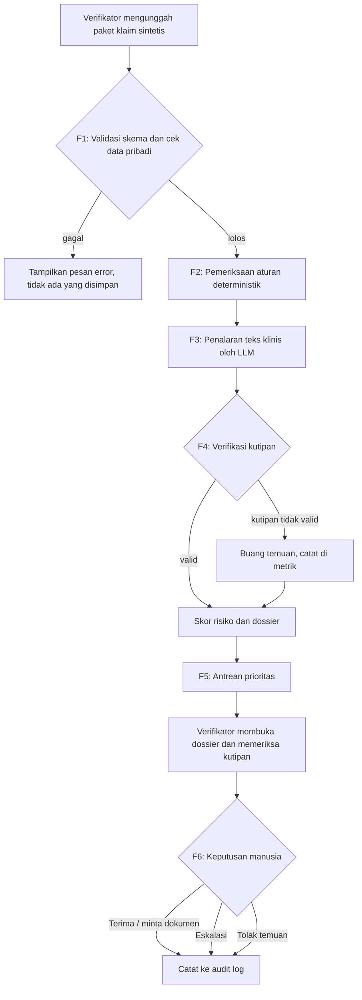

# Lean PRD — Claim Investigator Agent

**Event:** Healthkathon 2026 · Detect Smarter, Protect JKN **Kategori / sub-kategori:** 3.1 Efisiensi Risiko Faskes · Upcoding & Unbundling **Status:** Draf v0.1, 9 Okt 2026. Turunan dari Concept Brief dan Research Brief. **Level kematangan target:** Prototype pada data sintetis (jujur, bukan MVP dengan pengguna nyata).

---

## 1. Tujuan dan Non-Goals

### 1.1 Tujuan

| # | Tujuan | Cara tahu tercapai |
| --- | --- | --- |
| G1 | Mengubah satu klaim sintetis menjadi **dossier berbukti** yang bisa ditinjau verifikator | Demo end-to-end: unggah klaim → dossier → keputusan, tanpa langkah manual di luar UI |
| G2 | Menunjukkan bahwa setiap temuan **bisa ditelusuri ke kutipan dokumen asli** | Verifikasi kutipan lulus 100% pada uji injeksi (lihat F4) |
| G3 | Membuktikan metode pada set uji sintetis dan membandingkannya dengan **baseline aturan sederhana** | Laporan evaluasi yang dapat dijalankan ulang (F7) |
| G4 | Menjaga **manusia sebagai pengambil keputusan** dan semua keputusan tercatat | Audit log lengkap (F6) |
| G5 | Menyediakan bahan yang cukup untuk 9 komponen wajib proposal (maks. 20 slide) | Checklist bagian 7 terpenuhi |

### 1.2 Non-goals (sengaja tidak dikerjakan)

- Memutuskan fraud atau menolak/membayar klaim secara otomatis.
- Memakai **data peserta JKN riil** atau rekam medis asli.
- Integrasi nyata ke VEDIKA, V-Claim, atau sistem BPJS lain.
- Mendeteksi phantom billing, self-referral, atau modus di luar upcoding/unbundling.
- Memberi klaim akurasi, penghematan, atau dampak nasional sebagai fakta terbukti.
- Melayani sisi RS (validasi pra-kirim) atau menjadi produk dua sisi.
- Melatih model sendiri; memakai model yang tersedia.

---

## 2. Prioritas Fitur

### P0 — Wajib (tanpa ini demo tidak sah)

| ID | Fitur | Fungsi satu kalimat |
| --- | --- | --- |
| **F1** | Intake klaim sintetis | Menerima satu paket klaim (data klaim terstruktur + resume medis teks + penunjang + obat) dan memvalidasinya |
| **F2** | Pemeriksaan aturan deterministik | Mengecek kesesuaian kode diagnosis/tindakan dengan tabel referensi, lama rawat, dan pola episode berulang (indikasi unbundling) |
| **F3** | Penalaran teks klinis (LLM) | Membandingkan teks resume dengan kode diagnosis dan menghasilkan temuan terstruktur |
| **F4** | Verifikasi kutipan | Memastikan setiap kutipan bukti benar-benar ada di dokumen sumber; temuan tanpa kutipan valid dibuang |
| **F5** | Antrean prioritas dan dossier | Mengurutkan klaim berdasarkan indikasi risiko dan menampilkan dossier per klaim |
| **F6** | Keputusan manusia dan audit log | Verifikator memilih tindakan dan alasan; semua tercatat |
| **F7** | Set uji sintetis dan evaluasi | 30–50 kasus (termasuk pengganggu salah-koding tidak sengaja) dan laporan perbandingan dengan baseline |

### P1 — Jika sempat (urut dari paling bernilai)

| ID | Fitur | Syarat dikerjakan |
| --- | --- | --- |
| P1-a | Pembanding antar RS sebanding (statistik sintetis) | Semua P0 lolos acceptance criteria |
| P1-b | Ekspor dossier ke PDF | F5 stabil |
| P1-c | Umpan balik verifikator (alasan penolakan dipakai untuk catatan evaluasi, bukan pelatihan otomatis) | F6 stabil |
| P1-d | Halaman ringkasan metrik evaluasi di UI | F7 selesai |
| P1-e | Dukungan dokumen pindaian (OCR) | Ada sampel dokumen dan waktu tersisa |

### P2 — Diabaikan di hackathon (masuk peta jalan saja)

Integrasi sistem BPJS · data riil dengan izin resmi · auto-reject/auto-pending · phantom/repeat billing, self-referral, cloning · validasi pra-kirim sisi RS · autentikasi multi-pengguna dan peran · dukungan transisi iDRG · aplikasi mobile · model yang dijalankan di lingkungan tertutup (hanya dijelaskan di arsitektur).

---

## 3. User Stories

Pengguna utama: **verifikator klaim BPJS**. Pengguna sekunder: **auditor / tim anti-fraud**.

| ID | Sebagai | Saya ingin | Agar | Fitur |
| --- | --- | --- | --- | --- |
| US1 | Verifikator | mengunggah paket klaim dan langsung diberi tahu bila datanya tidak lengkap | tidak membuang waktu pada klaim yang tidak bisa diperiksa | F1 |
| US2 | Verifikator | melihat klaim yang paling layak diperiksa lebih dulu | waktu saya terpakai pada klaim berisiko | F5 |
| US3 | Verifikator | membaca alasan mengapa diagnosis tampak tidak sesuai dengan resume | saya dapat menilai sendiri, bukan percaya skor | F2, F3, F5 |
| US4 | Verifikator | mengklik tiap bukti dan melihat teks aslinya | saya yakin bukti tidak dikarang | F4, F5 |
| US5 | Verifikator | melihat penjelasan alternatif yang tidak mencurigakan | saya tidak menuduh RS yang hanya salah koding | F3, F5 |
| US6 | Verifikator | menerima, menolak, atau meminta pemeriksaan lanjut dengan alasan | keputusan saya terdokumentasi dan bisa dipertanggungjawabkan | F6 |
| US7 | Auditor | menelusuri siapa memutuskan apa, kapan, dan berdasarkan bukti apa | saya dapat mengaudit proses | F6 |
| US8 | Tim proyek | menjalankan evaluasi dengan satu perintah dan mendapat laporan yang sama setiap kali | klaim kinerja dapat diulang dan dipertanggungjawabkan | F7 |

---

## 4. Acceptance Criteria yang Bisa Dites

Format: **Given / When / Then**. Angka ambang adalah **target awal** dan boleh disesuaikan sebelum pengujian, tetapi harus ditetapkan sebelum menjalankan uji, bukan sesudahnya.

### F1 — Intake klaim sintetis

| ID | Kriteria | Cara uji |
| --- | --- | --- |
| F1-1 | **Given** paket klaim lengkap sesuai skema, **when** diunggah, **then** status "siap diperiksa" dan klaim muncul di daftar | Uji dengan 1 fixture valid |
| F1-2 | **Given** paket tanpa salah satu field wajib (kode diagnosis, resume, lama rawat), **when** diunggah, **then** ditolak dengan pesan yang menyebut nama field yang hilang, dan tidak ada klaim parsial tersimpan | Uji 1 fixture per field wajib |
| F1-3 | **Given** teks mengandung pola mirip NIK (16 digit) atau nomor kartu peserta, **when** diunggah, **then** ditolak dengan pesan "diduga data pribadi riil" dan isi tidak disimpan | Uji dengan fixture berisi pola 16 digit |
| F1-4 | **Given** file di luar format yang didukung atau melebihi batas ukuran, **when** diunggah, **then** ditolak dengan pesan format/ukuran yang jelas | Uji 2 fixture |

### F2 — Pemeriksaan aturan deterministik

| ID | Kriteria | Cara uji |
| --- | --- | --- |
| F2-1 | **Given** kombinasi diagnosis-tindakan yang tidak ada di tabel referensi, **when** diperiksa, **then** muncul flag "kombinasi tidak lazim" dengan kode yang bersangkutan | Fixture yang diketahui jawabannya |
| F2-2 | **Given** lama rawat di luar rentang tabel referensi untuk diagnosis itu, **when** diperiksa, **then** muncul flag lama rawat beserta nilai aktual dan rentang referensi | Fixture batas bawah dan atas |
| F2-3 | **Given** pasien dan diagnosis yang sama dengan klaim lain dalam jendela N hari (N dapat dikonfigurasi), **when** diperiksa, **then** muncul flag "indikasi episode terpecah" yang mencantumkan ID klaim terkait | Fixture 2–3 klaim terkait |
| F2-4 | **Given** input yang sama dijalankan dua kali, **then** keluaran identik 100% (deterministik) | Jalankan 2×, bandingkan |
| F2-5 | **Given** 10 fixture berlabel jawaban, **when** diperiksa, **then** hasil flag sesuai label 10/10 | Tes otomatis |

> **Batasan data referensi:** tabel referensi dibangun dari subset kecil kode ICD-10/ICD-9-CM dan tarif INA-CBG yang publik, dikurasi manual. Tarif dan aturan di prototipe **tidak boleh disebut sebagai tarif resmi** sebelum diverifikasi ke Permenkes terkait.

### F3 — Penalaran teks klinis (LLM)

| ID | Kriteria | Cara uji |
| --- | --- | --- |
| F3-1 | **Given** klaim valid, **when** diproses, **then** keluaran LLM sesuai skema JSON (jenis temuan, uraian, kutipan, keyakinan, penjelasan alternatif) pada 100% kasus uji; keluaran tidak valid memicu satu kali percobaan ulang lalu dianggap gagal (lihat error state E3) | Jalankan seluruh set uji, hitung kepatuhan skema |
| F3-2 | **Given** resume yang konsisten dengan diagnosis, **when** diproses, **then** tidak ada temuan jenis "diagnosis tidak didukung" | Fixture kasus bersih |
| F3-3 | **Given** setiap temuan, **then** memuat minimal satu kutipan dan satu penjelasan alternatif non-curiga | Pemeriksaan skema otomatis |
| F3-4 | **Given** model dipanggil, **then** parameter acak/suhu dan versi model dicatat di log eksekusi agar hasil bisa dilacak | Periksa log |

### F4 — Verifikasi kutipan

| ID | Kriteria | Cara uji |
| --- | --- | --- |
| F4-1 | **Given** temuan dengan kutipan yang merupakan substring persis (setelah normalisasi spasi) dari dokumen sumber, **then** lolos dan tersimpan beserta posisi karakter | Fixture valid |
| F4-2 | **Given** temuan dengan kutipan yang **tidak ada** di dokumen (diinjeksi sengaja), **then** temuan dibuang dari dossier, dihitung di metrik "temuan ditolak verifikator kutipan", dan tidak pernah tampil ke verifikator | Injeksi 10 kutipan palsu; 10/10 dibuang |
| F4-3 | **Given** kutipan merujuk ke dokumen yang tidak ada dalam paket, **then** diperlakukan sebagai tidak valid | Fixture rujukan salah |
| F4-4 | **Given** seluruh temuan dalam satu klaim gugur, **then** dossier menampilkan hanya hasil aturan (F2) dengan catatan jelas bahwa analisis teks tidak menghasilkan temuan tervalidasi | Fixture |

### F5 — Antrean prioritas dan dossier

| ID | Kriteria | Cara uji |
| --- | --- | --- |
| F5-1 | **Given** beberapa klaim sudah diproses, **when** antrean dibuka, **then** terurut menurun berdasarkan skor risiko; skor sama diurutkan deterministik (misal ID klaim) | Fixture dengan skor diketahui |
| F5-2 | **Given** dossier dibuka, **then** memuat bagian: ringkasan klaim, temuan (aturan dan teks), kutipan bukti per temuan, tingkat keyakinan, penjelasan alternatif, dan tombol keputusan | Pemeriksaan elemen UI otomatis atau checklist manual |
| F5-3 | **Given** kutipan diklik, **then** tampil dokumen sumber dengan teks kutipan tersorot | Uji manual pada 3 kasus |
| F5-4 | **Given** seluruh teks dossier, **then** tidak mengandung kata penuduh (daftar terlarang minimal: "fraud", "penipuan", "terbukti", "curang") dan memakai pembingkaian "indikasi untuk ditinjau" | Pemindaian string otomatis |
| F5-5 | **Given** tidak ada temuan, **then** tampil "tidak ditemukan indikasi pada pemeriksaan ini" (bukan "klaim bersih/aman") | Fixture kasus bersih |
| F5-6 | **Given** satu klaim, **when** diproses dari unggah sampai dossier, **then** waktu tercatat; target awal ≤ 60 detik per klaim pada lingkungan demo | Ukur 10 klaim |

### F6 — Keputusan manusia dan audit log

| ID | Kriteria | Cara uji |
| --- | --- | --- |
| F6-1 | **Given** dossier terbuka, **then** tersedia tiga tindakan: "Terima temuan / minta dokumen tambahan", "Eskalasi ke tim anti-fraud", "Tolak temuan agent" | Pemeriksaan UI |
| F6-2 | **Given** "Tolak temuan" atau "Eskalasi", **when** alasan kosong, **then** tombol konfirmasi ditolak dan pesan meminta alasan | Uji UI |
| F6-3 | **Given** keputusan dikonfirmasi, **then** entri log berisi: ID klaim, keputusan, alasan, ID pengguna (pengguna demo), stempel waktu, dan versi hasil analisis | Periksa entri log |
| F6-4 | **Given** log keputusan, **then** bersifat tambah-saja (append-only): tidak ada fungsi ubah/hapus di UI maupun API | Tinjauan kode/API |
| F6-5 | **Given** sistem, **then** tidak ada jalur yang mengubah status pembayaran atau menolak klaim tanpa keputusan manusia | Tinjauan kode; tidak ada endpoint semacam itu |

### F7 — Set uji sintetis dan evaluasi

| ID | Kriteria | Cara uji |
| --- | --- | --- |
| F7-1 | **Given** set uji, **then** berisi minimal 30 kasus dengan komposisi tertulis: kasus upcoding tertanam, kasus unbundling tertanam, kasus bersih, dan kasus **pengganggu salah-koding tidak sengaja** | Periksa berkas komposisi |
| F7-2 | **Given** set uji, **then** setiap kasus punya label kebenaran, dan label dibuat atau ditinjau pihak yang **berbeda** dari pembangun sistem (jika akses pakar tidak ada, dinyatakan terbuka sebagai keterbatasan) | Dokumen pembuat/peninjau |
| F7-3 | **Given** satu perintah evaluasi, **then** menghasilkan laporan berisi: recall kasus tertanam, false positive pada pengganggu dan kasus bersih, hasil baseline aturan sederhana pada set yang sama, dan keandalan kutipan | Jalankan 2×; angka sama kecuali variasi model yang tercatat |
| F7-4 | **Given** laporan, **then** setiap angka diberi label "data sintetis" dan keterbatasan ditulis di laporan | Periksa laporan |
| F7-5 | **Given** hasil agent lebih buruk dari baseline pada metrik tertentu, **then** tetap dilaporkan apa adanya | Tinjauan laporan |

---

## 5. User Flow dan Error States

### 5.1 Alur utama

### 5.2 Error states

| ID | Kondisi | Perilaku sistem | Yang dilihat pengguna |
| --- | --- | --- | --- |
| E1 | Field wajib hilang atau format salah | Tolak; tidak ada data parsial tersimpan | Pesan menyebut field yang bermasalah |
| E2 | Terdeteksi pola data pribadi riil | Tolak dan jangan simpan isi | Pesan: input diduga memuat data pribadi riil, gunakan data sintetis |
| E3 | LLM gagal, timeout, atau keluaran tidak sesuai skema | Coba ulang satu kali; jika tetap gagal, lanjut dengan hasil aturan saja | Banner: "Analisis teks tidak tersedia, hanya hasil aturan" |
| E4 | Semua temuan LLM gugur di verifikasi kutipan | Tampilkan hanya hasil aturan (F4-4) | Catatan: analisis teks tidak menghasilkan temuan tervalidasi |
| E5 | Aturan dan LLM saling bertentangan (misal aturan menandai, teks mendukung) | Tampilkan keduanya, jangan digabung menjadi satu skor diam-diam | Dossier menyebut ketidaksepakatan dan menurunkan keyakinan |
| E6 | Dokumen penunjang tidak ada dalam paket | Tandai "bukti tidak tersedia", jangan menyimpulkan ketiadaan sebagai kesalahan RS | Saran "minta dokumen tambahan" sebagai opsi |
| E7 | Dokumen terlalu panjang untuk konteks model | Potong secara terdokumentasi atau proses per bagian; catat bagian yang tidak terbaca | Catatan bagian dokumen yang tidak dianalisis |
| E8 | Tidak ada temuan | Tampilkan "tidak ditemukan indikasi pada pemeriksaan ini" | Bukan label "aman" atau "bersih" |
| E9 | Konfirmasi keputusan tanpa alasan (untuk tolak/eskalasi) | Blokir konfirmasi | Pesan meminta alasan |
| E10 | Gagal menulis audit log | Batalkan keputusan; jangan anggap tersimpan | Pesan error dan ajakan coba ulang |

---

## 6. Constraint Hackathon dan Batasan MVP

### 6.1 Constraint dari panduan

| Aspek | Ketentuan | Implikasi |
| --- | --- | --- |
| Deliverable | PDF ≤ 20 slide, ≤ 10 MB | Prototype hanya pendukung bukti; slide harus berdiri sendiri |
| Pilihan | 1 kategori, 1 solusi | Tidak ada fitur lintas kategori |
| Data | Dilarang data peserta JKN riil tanpa izin | Semua data sintetis; pemeriksa pola data pribadi (F1-3) wajib |
| Tim | 1–3 orang | P0 harus bisa dikerjakan tim minimum (satu orang) |
| Penilaian | 6 dimensi, "dibuktikan bukan disebutkan" | Setiap klaim di slide harus punya bukti dari prototype atau sumber |
| Kematangan | Dinyatakan jujur | Dilabeli "Prototype pada data sintetis" |
| Dampak | Hindari overclaim | Dampak ditulis sebagai estimasi beserta asumsi |

### 6.2 Batasan MVP

- **Satu alur, satu pengguna utama.** Tidak ada multi-peran atau autentikasi nyata; cukup pengguna demo.
- **Satu jenis kasus utama:** rawat inap, upcoding diagnosis dan episode terpecah. Cakupan diagnosis dibatasi pada subset kecil kode yang dipilih (disebut eksplisit di dokumen).
- **Tabel referensi kecil dan dikurasi,** bukan seluruh ICD/INA-CBG. Dinyatakan sebagai keterbatasan.
- **Tanpa penyimpanan permanen data klaim** di luar sesi demo, kecuali set uji sintetis dan audit log.
- **Biaya dan latensi:** agent berlapis (filter aturan dulu, LLM hanya untuk klaim yang dijalankan); target ≤ 60 detik per klaim (F5-6), tanpa klaim skalabilitas di luar yang diukur.
- **Hasil evaluasi tidak digeneralisasi** ke performa nasional.

### 6.3 Keputusan yang masih terbuka

| # | Pertanyaan | Dampak pada PRD |
| --- | --- | --- |
| Q1 | Tenggat dan format penilaian: PDF saja atau ada demo langsung? | Menentukan kedalaman UI dan apakah P1-b/P1-d perlu |
| Q2 | Akses ke pakar domain (koder, dokter, verifikator) untuk F7-2? | Tanpa itu F7-2 hanya bisa dipenuhi sebagian; wajib dicatat sebagai keterbatasan |
| Q3 | Pilihan model dan lingkungan jalan (lokal/layanan)? | Mempengaruhi F3-4, biaya, dan narasi privasi |
| Q4 | Nilai N untuk jendela episode (F2-3) | Perlu rujukan aturan/pakar; sementara parameter konfigurasi |
| Q5 | Status iDRG vs INA-CBG | Tabel referensi dibuat modular supaya mudah diganti |

---

## 7. Gate: Verifikasi P0

**Aturan gate:** fitur P0 baru dianggap selesai bila (a) semua acceptance criteria-nya lulus, dan (b) bukti lulusnya bisa ditunjukkan.

| Fitur | Perilaku yang jelas | Bukti verifikasi | Jumlah kriteria |
| --- | --- | --- | --- |
| F1 Intake | Terima/tolak berdasarkan skema dan pola data pribadi | Tes otomatis atas fixture valid dan tidak valid | 4 |
| F2 Aturan | Flag deterministik dengan nilai dan rujukan | 10/10 fixture berlabel + uji dua kali jalan | 5 |
| F3 LLM | Temuan sesuai skema, dengan kutipan dan alternatif | Kepatuhan skema 100% pada set uji | 4 |
| F4 Kutipan | Kutipan palsu tidak pernah sampai ke pengguna | Uji injeksi 10/10 | 4 |
| F5 Dossier | Antrean terurut; dossier lengkap, bahasa netral | Pemindaian string + checklist UI | 6 |
| F6 Keputusan | Tiga tindakan, alasan wajib, log append-only | Uji UI + tinjauan kode | 5 |
| F7 Evaluasi | Satu perintah menghasilkan laporan yang bisa diulang | Jalankan 2×, bandingkan | 5 |

**Definition of Done untuk demo:** satu klaim sintetis dapat melewati seluruh alur pada diagram 5.1, termasuk satu skenario error (E3 atau E4), dan laporan F7 tersedia dengan label data sintetis.

**Pemotongan bila waktu terbatas:** urutan pertahanan P0 bila harus dikurangi: F1, F2, F5, F6 adalah inti alur; F3 dan F4 harus selalu dikerjakan **bersama** (LLM tanpa verifikasi kutipan tidak boleh tampil ke pengguna); F7 tidak boleh dipotong karena menjadi satu-satunya bukti klaim kinerja.