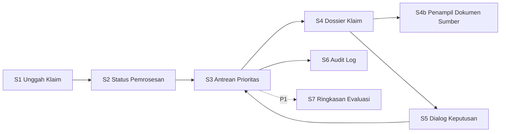
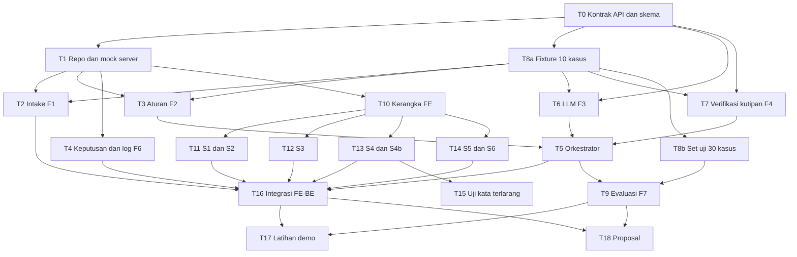

# Dokumen 5 — UI Flow & Task Plan

**Proyek:** Claim Investigator Agent · Healthkathon 2026 **Turunan dari:** Concept Brief dan Lean PRD (ID fitur F1–F7, kriteria F\*-n, dan error E1–E10 merujuk ke Lean PRD) **Tim:** 3 developer, yaitu **BE1**, **BE2** (keduanya mengerjakan sisi AI), dan **FE** **Status:** Draf v0.1, 9 Okt 2026

> **Catatan jadwal:** tenggat belum diketahui (Q1 di Lean PRD). Rencana ini memakai **fase dan urutan ketergantungan**, bukan tanggal. Begitu tenggat diketahui, petakan Fase 0–3 ke kalender dan terapkan *cut line* di bagian 7.

---

## 1. Screen Map dan Urutan Interaksi

### 1.1 Peta layar

| Layar | Fungsi | Fitur | Prioritas |
| --- | --- | --- | --- |
| **S1 Unggah Klaim** | Unggah paket klaim sintetis, lihat hasil validasi | F1 | P0 |
| **S2 Status Pemrosesan** | Menampilkan tahap: validasi → aturan → analisis teks → verifikasi kutipan → selesai | F1–F5 | P0 |
| **S3 Antrean Prioritas** | Daftar klaim terurut berdasarkan indikasi risiko | F5 | P0 |
| **S4 Dossier Klaim** | Ringkasan klaim, temuan, bukti, keyakinan, penjelasan alternatif, tombol keputusan | F2–F5 | P0 |
| **S4b Penampil Dokumen Sumber** | Panel dokumen asli dengan teks kutipan tersorot | F4, F5 | P0 |
| **S5 Dialog Keputusan** | Pilih tindakan dan isi alasan | F6 | P0 |
| **S6 Audit Log** | Daftar keputusan, hanya-baca | F6 | P0 |
| **S7 Ringkasan Evaluasi** | Metrik evaluasi data sintetis | F7 | P1 |

### 1.2 Urutan interaksi utama (untuk demo)

| # | Pengguna melakukan | Sistem merespons | Layar |
| --- | --- | --- | --- |
| 1 | Memilih/menyeret paket klaim | Validasi skema dan cek pola data pribadi | S1 |
| 2 | Menekan "Periksa" | Menampilkan tahap pemrosesan berjalan | S2 |
| 3 | (menunggu) | Otomatis membuka antrean saat selesai | S2 → S3 |
| 4 | Melihat daftar terurut, membuka klaim teratas | Menampilkan dossier | S3 → S4 |
| 5 | Membaca temuan, mengklik satu kutipan | Membuka dokumen sumber dengan teks tersorot | S4 → S4b |
| 6 | Menekan salah satu tindakan keputusan | Membuka dialog, alasan wajib untuk Tolak/Eskalasi | S4 → S5 |
| 7 | Mengonfirmasi | Menulis audit log, kembali ke antrean, status klaim berubah | S5 → S3 |
| 8 | Membuka riwayat | Menampilkan entri log (hanya-baca) | S3 → S6 |

---

## 2. State Layar: Loading, Empty, Success, Error

Setiap state harus diimplementasikan dan **terlihat** dalam demo (bisa dipicu lewat fixture).

| Layar | Loading | Empty | Success | Error (rujuk E-kode) |
| --- | --- | --- | --- | --- |
| **S1** | Indikator unggah dan "memvalidasi…" | Area unggah dengan petunjuk format dan tautan contoh paket sintetis | Ringkasan paket + tombol "Periksa" aktif | Pesan menyebut field yang hilang (E1); pesan "diduga data pribadi riil, gunakan data sintetis" (E2); format/ukuran tidak didukung |
| **S2** | Stepper 5 tahap dengan tahap aktif | Tidak berlaku (hanya muncul setelah S1) | Semua tahap centang, lanjut otomatis | Banner "Analisis teks tidak tersedia, hanya hasil aturan" (E3); tombol "Coba lagi" bila seluruh proses gagal |
| **S3** | Kerangka (skeleton) baris daftar | "Belum ada klaim diperiksa" + tombol ke S1 | Daftar terurut: ID klaim, indikasi utama, tingkat keyakinan, status keputusan | Pesan gagal memuat + coba lagi |
| **S4** | Skeleton dossier | Tidak berlaku. Jika tidak ada temuan: "Tidak ditemukan indikasi pada pemeriksaan ini" (E8), bukan "aman/bersih" | Bagian lengkap: ringkasan, temuan, kutipan, keyakinan, alternatif, tombol keputusan | Hanya hasil aturan dengan catatan (E4); "bukti tidak tersedia" (E6); catatan bagian dokumen tidak dianalisis (E7); ketidaksepakatan aturan vs teks ditampilkan (E5) |
| **S4b** | Skeleton dokumen | Tidak berlaku | Dokumen tampil, kutipan tersorot dan tergulir ke posisi | "Dokumen sumber tidak ditemukan" bila rujukan salah |
| **S5** | Tombol konfirmasi menampilkan proses | Tidak berlaku | Toast "Keputusan tercatat", kembali ke S3 | Konfirmasi diblokir saat alasan kosong (E9); "Keputusan gagal dicatat, coba lagi" (E10) |
| **S6** | Skeleton tabel | "Belum ada keputusan tercatat" | Tabel: waktu, klaim, keputusan, alasan, pengguna | Gagal memuat + coba lagi |

**Aturan tampilan lintas layar:**

- Label data: header permanen "Data sintetis, bukan data peserta JKN".
- Bahasa: "indikasi untuk ditinjau"; tidak memakai kata penuduh (F5-4).
- Skor risiko selalu disertai alasan, bukan angka telanjang.

---

## 3. Kontrak Antar-Peran (disepakati di Fase 0)

FE dan BE bisa bekerja paralel hanya bila kontrak ini dibekukan lebih dulu. Perubahan setelah beku harus diumumkan ke seluruh tim.

| Endpoint (usulan) | Dipakai oleh | Isi singkat |
| --- | --- | --- |
| `POST /claims` | S1 | Unggah paket, balas ID klaim atau daftar error validasi |
| `GET /claims/{id}/status` | S2 | Tahap saat ini + status (berjalan/selesai/sebagian/gagal) |
| `GET /claims` | S3 | Daftar klaim terurut: ID, skor risiko, indikasi utama, status keputusan |
| `GET /claims/{id}/dossier` | S4 | Temuan (sumber: aturan/teks), kutipan dengan ID dokumen dan posisi karakter, keyakinan, alternatif, flag state (E3–E8) |
| `GET /claims/{id}/documents/{docId}` | S4b | Teks dokumen sumber |
| `POST /claims/{id}/decision` | S5 | Tindakan + alasan, balas sukses atau error |
| `GET /audit-log` | S6 | Daftar entri hanya-baca |
| `GET /evaluation/latest` (P1) | S7 | Laporan evaluasi terakhir |

Keluaran akhir Fase 0: **skema JSON dossier** dan **contoh respons tiap state** (sukses, tanpa temuan, hanya-aturan, error). Ini menjadi fixture FE sekaligus target uji BE.

---

## 4. Peran dan Pembagian Kerja

| PIC | Fokus | Sisi AI |
| --- | --- | --- |
| **BE1** | Platform alur: API, intake (F1), mesin aturan (F2), keputusan dan audit log (F6), orkestrasi pipeline, antrean dan skor risiko | Orkestrasi agent berlapis (urutan filter aturan → LLM), baseline aturan untuk evaluasi |
| **BE2** | Lapisan AI: penalaran teks (F3), verifikasi kutipan (F4), evaluasi dan set uji (F7) | Prompt, skema keluaran, penanganan kegagalan model, uji injeksi |
| **FE** | Seluruh layar S1–S6 (S7 bila P1), penanganan semua state, bahan visual proposal | Tampilan kutipan, keyakinan, penjelasan alternatif |

**Cross-review (aturan tim):** pembuat tidak memeriksa karyanya sendiri. Kolom *Pemeriksa* di bawah menentukan siapa yang mengesahkan Definition of Done.

---

## 5. Daftar Task

**Ukuran:** S (kecil), M (sedang), L (besar). Estimasi relatif, bukan jam. **Referensi AC:** merujuk ke acceptance criteria di Lean PRD.

### Fase 0 — Fondasi bersama

| ID | Task | PIC | Pendukung | Depends | Ukuran | Pemeriksa | Selesai bila (DoD task) |
| --- | --- | --- | --- | --- | --- | --- | --- |
| **T0** | Bekukan kontrak API, skema JSON paket klaim dan dossier, contoh respons tiap state | BE1 | BE2, FE | — | S | FE | Dokumen kontrak ada; 4 contoh respons (sukses, tanpa temuan, hanya-aturan, error) valid terhadap skema; disetujui ketiganya |
| **T1** | Repo, struktur proyek, env, mock server dari contoh T0, skrip jalan satu perintah | BE1 | — | T0 | S | BE2 | Clone baru bisa jalan dengan satu perintah; mock server mengembalikan contoh T0 |
| **T8a** | Fixture awal: 10 kasus sintetis (termasuk 2 pengganggu) | BE2 | BE1 | T0 | S | BE1 | 10 kasus sesuai skema T0, tiap kasus punya label jawaban tertulis |

### Fase 1 — Pembangunan paralel

**Jalur BE1**

| ID | Task | PIC | Depends | Ukuran | Pemeriksa | Selesai bila (DoD task) |
| --- | --- | --- | --- | --- | --- | --- |
| **T2** | Intake: validasi skema, pemeriksa pola data pribadi, penyimpanan sesi (F1) | BE1 | T1, T8a | M | BE2 | F1-1 sampai F1-4 lulus lewat tes otomatis |
| **T3** | Mesin aturan + tabel referensi subset (kombinasi, lama rawat, episode terpecah) (F2) | BE1 | T1, T8a | L | BE2 | F2-1 sampai F2-5 lulus; subset kode terdaftar di dokumen dan ditandai "bukan tarif resmi" |
| **T4** | Keputusan dan audit log append-only (F6) | BE1 | T1 | M | FE | F6-1 sampai F6-5 lulus; tidak ada endpoint ubah/hapus log |

**Jalur BE2**

| ID | Task | PIC | Depends | Ukuran | Pemeriksa | Selesai bila (DoD task) |
| --- | --- | --- | --- | --- | --- | --- |
| **T6** | Modul penalaran teks: prompt, skema keluaran, retry sekali, pencatatan versi/parameter (F3) | BE2 | T0, T8a | L | BE1 | F3-1 sampai F3-4 lulus pada 10 fixture; kegagalan model menghasilkan sinyal E3, bukan crash |
| **T7** | Verifikasi kutipan + uji injeksi (F4) | BE2 | T0, T8a | M | BE1 | F4-1 sampai F4-4 lulus; 10/10 kutipan palsu terbuang |
| **T8b** | Lengkapi set uji menjadi minimal 30 kasus; minta peninjauan pakar bila ada akses | BE2 | T8a | M | BE1 | Berkas komposisi (upcoding, unbundling, bersih, pengganggu) dan label; pembuat dan peninjau tercatat (F7-1, F7-2) |

**Jalur FE** (bekerja di atas mock server T1, tanpa menunggu BE)

| ID | Task | PIC | Depends | Ukuran | Pemeriksa | Selesai bila (DoD task) |
| --- | --- | --- | --- | --- | --- | --- |
| **T10** | Kerangka aplikasi: routing, klien API, header "data sintetis", layer mock | FE | T1 | S | BE1 | Semua layar punya rute; klien API bisa ganti antara mock dan BE nyata lewat satu konfigurasi |
| **T11** | S1 Unggah + S2 Status pemrosesan, termasuk semua state di bagian 2 | FE | T10 | M | BE2 | Semua state S1/S2 bisa dipicu dari fixture dan sesuai tabel bagian 2 |
| **T12** | S3 Antrean prioritas, termasuk state | FE | T10 | S | BE1 | Urutan menurun benar pada fixture; empty/loading/error tampil |
| **T13** | S4 Dossier + S4b penampil sumber dengan penyorotan kutipan | FE | T10 | L | BE2 | F5-2 dan F5-3 lulus pada 3 fixture; state E4–E8 tampil benar |
| **T14** | S5 Dialog keputusan + S6 Audit log | FE | T10 | M | BE1 | F6-1, F6-2 lulus di UI; E9/E10 tampil |

### Fase 2 — Integrasi

| ID | Task | PIC | Pendukung | Depends | Ukuran | Pemeriksa | Selesai bila (DoD task) |
| --- | --- | --- | --- | --- | --- | --- | --- |
| **T5** | Orkestrator pipeline: aturan → LLM → verifikasi kutipan → skor risiko → antrean; penanganan E3, E4, E5, E6, E7 (F5 sisi BE) | BE1 | BE2 | T3, T6, T7 | L | BE2 | F5-1, F5-4, F5-5, F5-6 lulus; skenario E3 dan E4 dapat dipicu di lingkungan uji |
| **T16** | Ganti mock dengan BE nyata, perbaiki ketidaksesuaian kontrak | FE | BE1 | T2, T4, T5, T11–T14 | M | BE2 | Seluruh alur 1.2 berjalan di BE nyata tanpa mock |
| **T15** | Uji pemindaian kata terlarang pada seluruh keluaran dossier; periksa konsistensi label "data sintetis" | FE | BE2 | T13 | S | BE1 | F5-4 lulus otomatis di CI |

### Fase 3 — Evaluasi, demo, dan proposal

| ID | Task | PIC | Pendukung | Depends | Ukuran | Pemeriksa | Selesai bila (DoD task) |
| --- | --- | --- | --- | --- | --- | --- | --- |
| **T9** | Harness evaluasi, baseline aturan sederhana, laporan (F7) | BE2 | BE1 (baseline) | T5, T8b | M | BE1 | F7-3 sampai F7-5 lulus; dijalankan dua kali dengan hasil sama (kecuali variasi model yang tercatat) |
| **T17** | Latihan demo end-to-end dengan skrip, termasuk satu skenario error | Semua | — | T16, T9 | M | Seluruh tim | Satu klaim melewati diagram alur di Lean PRD 5.1; skenario E3 atau E4 ditunjukkan; dijalankan dari lingkungan bersih sekali tanpa intervensi |
| **T18** | Slide proposal (≤20, PDF, ≤10 MB), tangkapan layar, video/tautan demo | FE (visual, alur) | BE1 (arsitektur, privasi, UU PDP), BE2 (evaluasi, dampak, keterbatasan) | T9, T16 (bahan); kerangka bisa mulai sejak Fase 1 | M | Seluruh tim | Checklist akhir panduan terpenuhi; setiap angka di slide berlabel "data sintetis" atau sumber; ukuran file diperiksa |

### Task P1 (hanya setelah semua P0 lulus)

| ID | Task | PIC | Depends |
| --- | --- | --- | --- |
| P1-a | Pembanding antar RS sebanding (statistik sintetis) | BE1 | T5 |
| P1-b | Ekspor dossier ke PDF | FE | T16 |
| P1-c | Umpan balik verifikator ke catatan evaluasi | BE1 | T4 |
| P1-d | S7 Ringkasan evaluasi di UI | FE | T9 |
| P1-e | Dukungan dokumen pindaian (OCR) | BE2 | T7 |

---

## 6. Dependency dan Pekerjaan Paralel

### 6.1 Graf ketergantungan

### 6.2 Apa yang paralel

| Fase | BE1 | BE2 | FE |
| --- | --- | --- | --- |
| **0** | T0 (lead), T1 | T8a | Review kontrak T0 |
| **1** | T2, T3, T4 | T6, T7, T8b | T10 → T11, T12, T13, T14 (di atas mock) |
| **2** | T5 (dengan BE2), lalu dukung T16 | Dukung T5, uji E3/E4 | T16 (dengan BE1), T15 |
| **3** | Baseline T9, arsitektur untuk T18 | T9 (lead), evaluasi untuk T18 | T18 (visual), T17 |

### 6.3 Titik sinkronisasi (tidak boleh dilewati)

| # | Titik | Syarat lolos |
| --- | --- | --- |
| **SYNC-1** | Akhir Fase 0 | Kontrak T0 beku dan disetujui tiga orang |
| **SYNC-2** | Sebelum T5 | T3, T6, T7 masing-masing lulus DoD di fixture 10 kasus |
| **SYNC-3** | Sebelum T16 | T2, T4, T5 jalan; seluruh layar FE lulus DoD di mock |
| **SYNC-4** | Sebelum T17 | T16 dan T9 selesai; semua P0 lulus gate |

### 6.4 Risiko jalur kritis

Jalur terpanjang: **T0 → T6/T7 → T5 → T16 → T17**. Keterlambatan di T6, T7, atau T5 langsung menahan demo. Mitigasi:

- BE2 menyelesaikan T6 dan T7 lebih dulu daripada T8b.
- BE1 memprioritaskan T5 setelah T3, dan menunda T4 bila perlu (T4 hanya dibutuhkan T16).
- FE tidak menunggu BE karena bekerja di atas mock; risiko FE ada di T13 (ukuran L), jadi mulai T13 lebih awal daripada T11/T12 bila perlu.

---

## 7. Definition of Done

### 7.1 DoD tingkat task (berlaku untuk semua)

Sebuah task dianggap selesai bila **semuanya** terpenuhi:

1. Kriteria di kolom "Selesai bila" lulus, dibuktikan dengan **tes otomatis, keluaran uji, atau tangkapan layar**, bukan pernyataan lisan.
2. **Pemeriksa** (bukan pembuat) menyatakan lulus.
3. Perubahan sudah masuk cabang utama dan proyek tetap bisa dijalankan dengan satu perintah.
4. Tidak ada data riil atau data yang tampak seperti data pribadi dalam repo (fixture, log, tangkapan layar).
5. Bila mengubah kontrak T0: tim sudah diberi tahu.

### 7.2 DoD tingkat fitur P0 (gate)

| Fitur | Task | Lolos bila | Bukti |
| --- | --- | --- | --- |
| F1 | T2, T11 | F1-1 sampai F1-4 lulus; state S1 tampil | Hasil tes + tangkapan layar |
| F2 | T3 | F2-1 sampai F2-5 lulus | Hasil tes 10/10 + uji dua kali jalan |
| F3 | T6 | F3-1 sampai F3-4 lulus | Laporan kepatuhan skema |
| F4 | T7 | F4-1 sampai F4-4 lulus | Hasil uji injeksi 10/10 |
| F5 | T5, T12, T13, T15 | F5-1 sampai F5-6 lulus | Tes + pemindaian string + checklist UI |
| F6 | T4, T14 | F6-1 sampai F6-5 lulus | Tes + tinjauan kode (tanpa endpoint ubah/hapus log) |
| F7 | T8a, T8b, T9 | F7-1 sampai F7-5 lulus | Laporan evaluasi dua kali jalan |

### 7.3 DoD tingkat demo (Definition of Done proyek)

- Satu klaim sintetis melewati seluruh alur 1.2 di lingkungan demo tanpa campur tangan manual di luar UI.
- Setidaknya satu skenario error (E3 atau E4) ditunjukkan dan ditangani dengan benar.
- Laporan evaluasi F7 tersedia, berlabel "data sintetis", dan menyertakan hasil baseline.
- Proposal ≤ 20 slide, PDF, ≤ 10 MB, memuat 9 komponen wajib dan membahas UU PDP, bias AI, dan human-in-the-loop.

### 7.4 Cut line (bila waktu tidak cukup)

Pemotongan dilakukan dari bawah ke atas. Ketentuan yang **tidak boleh dilanggar:**

| Urutan potong | Yang dipotong | Catatan |
| --- | --- | --- |
| 1 | Seluruh P1 | Tidak mengganggu P0 |
| 2 | S6 Audit log di UI (log tetap dicatat di BE, tampilkan lewat berkas) | Hanya bila FE terlambat; F6-3 dan F6-4 tetap harus lulus |
| 3 | Jumlah kasus uji turun ke 30 (minimum) | Komposisi F7-1 tetap harus lengkap |
| 4 | Cakupan kode diagnosis dipersempit | Tulis eksplisit sebagai keterbatasan |

**Tidak boleh dipotong:** F4 selalu ikut F3 (analisis LLM tanpa verifikasi kutipan tidak boleh tampil ke pengguna); F7 (satu-satunya bukti klaim kinerja); F1-3 (pemeriksa data pribadi); label "data sintetis".

---

## 8. Ritme Kerja dan Pemeriksaan

| Kegiatan | Isi | Siapa |
| --- | --- | --- |
| **Sinkronisasi singkat harian** | Apa selesai, apa dikerjakan, apa menghambat; tidak lebih dari beberapa menit | Semua |
| **Gerbang SYNC-1 sampai SYNC-4** | Pemeriksaan syarat lolos di 6.3 sebelum fase berikutnya | Semua |
| **Cross-review** | Pemeriksa di tabel task mengesahkan DoD | Sesuai kolom Pemeriksa |
| **Papan task** | Satu papan dengan kolom: Belum, Dikerjakan, Menunggu Review, Selesai; setiap kartu memuat ID task, PIC, pemeriksa | FE menyiapkan, semua memakai |

**Gate dokumen ini:** tim tahu apa yang dikerjakan (bagian 5), siapa yang mengerjakan (kolom PIC), dan bagaimana hasilnya diperiksa (kolom Pemeriksa dan Selesai bila, serta bagian 7).

---

## 9. Hal Terbuka yang Mempengaruhi Rencana

| # | Pertanyaan | Dampak |
| --- | --- | --- |
| Q1 | Tenggat dan format penilaian (PDF saja atau ada demo)? | Menentukan pemetaan fase ke kalender dan seberapa banyak T13/T17 perlu dipoles |
| Q2 | Akses ke pakar domain? | Menentukan apakah T8b memenuhi F7-2 penuh atau hanya sebagian |
| Q3 | Model dan lingkungan jalan yang dipakai? | Mempengaruhi T6, biaya, dan narasi privasi |
| Q4 | Nilai N jendela episode terpecah? | Parameter konfigurasi T3 |
| Q5 | Status iDRG vs INA-CBG? | Tabel referensi T3 dibuat modular |