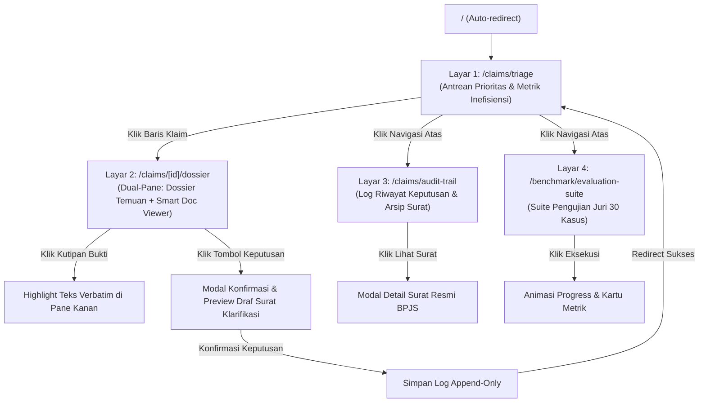

# 5 — UI Flow & Task Plan

**Tema Hackathon:** Detect Smarter, Protect JKN  
**Kategori:** Efisiensi Risiko Fasilitas Kesehatan (Kategori 3.1)  
**Dokumen Rujukan:** [`docs/3a-features.md`](file:///d:/Projects/Web%20Shi/healthkaton/docs/3a-features.md), [`docs/3b-end-to-end-flows.md`](file:///d:/Projects/Web%20Shi/healthkaton/docs/3b-end-to-end-flows.md), [`docs/4-technical-design.md`](file:///d:/Projects/Web%20Shi/healthkaton/docs/4-technical-design.md)  
**Komposisi Tim:**
- **Maul:** Frontend Engineer (Next.js 15, Tailwind, `shadcn/ui`, Dual-Pane Workspace, UI States)
- **Ojan:** Backend & AI Engineer (FastAPI, Neon DB Core, Gemini Flash Pipeline, Verbatim Grounding)
- **Koh Ariq:** Backend & AI Engineer (Groq Alkes Engine, NVIDIA/pgvector Cloning, Seeding & Benchmark Suite)

**Gate:** Tim tahu persis apa yang dikerjakan, siapa yang mengerjakan (PIC), dependensi antartask, dan bagaimana hasilnya diverifikasi (Definition of Done).

---

## 1. Screen Map & Urutan Interaksi (Navigation Flow)

### Urutan Interaksi Pengguna (User Journey):
1. **Verifikator Masuk:** Membuka `/claims/triage`. Melihat ringkasan metrik operasional yang tenang dan memilih klaim berisiko tinggi teratas.
2. **Masuk ke Ruang Telaah:** Membuka `/claims/:id/dossier`. Membaca kartu temuan diskrepansi Upcoding, Inflated Bills, dan Note Cloning pada pane kiri yang berbatas 1px bersih.
3. **Verifikasi Bukti:** Mengklik kutipan pada kartu temuan $\rightarrow$ Teks laporan operasi atau resume medis di pane kanan langsung tersorot secara statis (`bg-amber-100/80`) dengan *smooth scroll* (**tanpa animasi berdenyut / strictly no pulse animation** dan **tanpa efek glow**).
4. **Eksekusi Keputusan:** Menekan tombol keputusan solid ber-radius 4px (`Minta Konfirmasi RS` / `Koreksi Kode`) $\rightarrow$ Muncul draf surat resmi ke RS $\rightarrow$ Verifikator mengisi catatan justifikasi $\rightarrow$ Konfirmasi $\rightarrow$ Kembali ke antrean dengan status terbarui.
5. **Auditor Memeriksa Arsip:** Membuka `/claims/audit-trail` untuk melihat seluruh rekaman waktu, catatan verifikator, dan draf surat resmi dalam format tabel yang tenang dan terbebas dari chip ornamen kepatuhan palsu.

---

## 2. Spesifikasi UI States (Loading, Empty, Success, Error)

Untuk menjamin kenyamanan pengguna dan mencegah tampilan antarmuka yang rusak, seluruh state mengikuti **UI Styling Guidelines** dan **Antislop Rules**:

| Halaman | Loading State | Empty State | Success State | Error State |
|---|---|---|---|---|
| **Layar 1: Triage Queue** (`/claims/triage`) | Skeleton table (5 baris netral) & 3 skeleton metrics card berbatas 1px. | Card netral tenang: *"Belum ada klaim yang memerlukan verifikasi. Seluruh klaim telah selesai ditelaah."* | Tabel antrean terisi lengkap dengan badge persegi panjang ber-radius 4px yang didiferensiasi dengan ikon fungsional dan teks ringkas (tanpa titik bulat status `●` dan tanpa rainbow badges). | Banner netral 1px beraksen merah terkontrol: *"Gagal memuat antrean klaim. Periksa koneksi backend."* + Tombol *Coba Lagi*. |
| **Layar 2: Dual-Pane Dossier** (`/claims/[id]/dossier`) | Dual skeleton: Pane kiri skeleton cards, pane kanan placeholder dokumen loading. | Teks netral: *"Tidak ditemukan diskrepansi anomali pada klaim ini."* | Dossier kartu temuan terisi rapi, teks dokumen termuat, tombol aksi aktif ber-radius 4px. | Banner peringatan 1px: *"Gagal memuat berkas rekam medis klaim ini."* |
| **Modal Upload** (F1) | Progres bar tenang: `Validasi Skema (30%)` $\rightarrow$ `Sanitasi PII (70%)` $\rightarrow$ `Integritas Berkas (100%)`. | Dropzone area bersih dengan garis putus-putus netral 1px. | Banner konfirmasi hijau tenang: *"Berkas klaim berhasil diunggah dan lolos sanitasi data."* | Banner peringatan: *"Validasi Gagal: Dokumen terdeteksi memuat identitas riil tanpa sanitasi PII."* |
| **Layar 3: Audit Trail** (`/claims/audit-trail`) | Skeleton baris log riwayat verifikasi. | Teks informasi: *"Belum ada riwayat keputusan verifikasi yang terekam."* | Daftar tabel log append-only dengan nomor referensi `tabular-nums` dan badge status persegi panjang yang bersih (tanpa chip dekoratif "UU PDP Valid"). | Banner error sistem pencatatan log. |
| **Layar 4: Benchmark Suite** (`/benchmark/evaluation-suite`) | Progres eksekusi batch kasus 1 s/d 30 berjalan transparan. | Panel awal: *"Siap menjalankan pengujian batch pada 30 dataset sintetis terstandar."* | Kartu metrik objektif (Recall $\ge 85\%$, FPR $\le 15\%$, Verbatim $100\%$, Latency $<60$s) dengan tipografi Plus Jakarta Sans angka `tabular-nums`. | Banner error jika eksekusi batch terputus. |

---

## 3. Matriks Pembagian Tugas & PIC (Team Task Matrix)

Tim dibagi menjadi **3 Jalur Paralel (Maul = FE, Ojan = BE Core & Gemini, Koh Ariq = BE AI & Seeding)**:

```mermaid
gantt
    title Jadwal Kerja Paralel Hackathon (3 Wave)
    dateFormat  X
    axisFormat  Day %d

    section Wave 1: Fondasi
    Setup Next.js & shadcn/ui (Maul)            :a1, 0, 2
    Setup FastAPI & Neon DDL (Ojan)             :a2, 0, 2
    Riset Prompt & Mock JSON Seed (Koh Ariq)     :a3, 0, 2

    section Wave 2: Core Engine
    FE Layar 1 Triage & Modal Upload (Maul)     :b1, 2, 4
    BE Fast Filter & Gemini Upcoding (Ojan)     :b2, 2, 5
    BE Groq Alkes & pgvector Cloning (Koh Ariq) :b3, 2, 5
    FE Layar 2 Dual-Pane & Highlight (Maul)     :b4, 4, 7

    section Wave 3: Integration
    BE Verbatim Grounding & Audit (Ojan)        :c1, 5, 7
    BE Benchmark Suite & Seeding (Koh Ariq)     :c2, 5, 7
    FE Layar 3 Audit & Layar 4 Benchmark (Maul) :c3, 6, 8
    End-to-End Testing & Polish (All)           :c4, 7, 9
```

---

## 4. Rincian Task Breakdown per Developer

### 4.1 Maul (Frontend Engineer)

| Task ID | Nama Task & Spesifikasi | Estimasi | Dependensi | Kriteria Lolos (DoD) |
|---|---|---|---|---|
| **FE-1** | **Setup Project Next.js 15 & Design System (Strict Anti-Slop & Attio Aesthetic)** - Inisialisasi Next.js 15 App Router + Tailwind CSS. - Pasang `shadcn/ui` + `lucide-react`. - **Standar Styling:** Terapkan tipografi **Plus Jakarta Sans** untuk seluruh teks, kode referensi, dan angka (`tabular-nums`, tanpa font mono kaku). - **Palet Warna BPJS:** Dominasi BPJS Green (`emerald-600/700`) dan BPJS Blue (`blue-600/700`); warna amber/red terisolasi hanya untuk anomali klinis riil. - **Bentuk Komponen:** Kontainer persegi panjang ber-radius 4px - 6px, **tanpa tombol/badge bentuk pil (`no rounded-full`)**, **tanpa titik bulat status (`no circular dots`)**, **tanpa teks eyebrow ornamental**, dan **tanpa garis aksen samping sepihak (`no border-left 3px`)**. - **Zero Fake Compliance Theater:** Menghilangkan ornamen banner "BSrE-BSSN" atau badge "UU PDP Valid". | 0.5 Hari | Tidak ada | Project berjalan di Next 15, lolos build tanpa error, design tokens terpasang rapi sesuai panduan styling. |
| **FE-2** | **Layar 1: Triage Dashboard (`/claims/triage`)** - Buat komponen `MetricHeader` (3 kartu ringkasan berbatas 1px netral, angka `tabular-nums`). - Buat `ClaimTable` dengan diferensiasi status berbasis ikon fungsional dan teks ringkas di dalam kontainer persegi panjang bersudut terkontrol. - Implementasikan filter dropdown kustom (RS, status risiko, modus anomali). - Buat `ModalUploadClaim` dengan area dropzone bersih. | 1 Hari | FE-1, BE-1 (Mock) | Tabel menampilkan data antrean, sorting prioritas berjalan, klik baris memicu navigasi ke `/claims/:id/dossier`. |
| **FE-3** | **Layar 2: Dual-Pane Workspace (`/claims/[id]/dossier`)** - Susun layout split 50:50 (Pane Kiri = Dossier, Pane Kanan = Doc Viewer). - Buat komponen `EvidenceCard` dengan status bobot bukti dan kutipan interaktif. - Implementasikan `ActionBar` fixed bottom dengan 4 tombol solid ber-radius 4px. | 1.5 Hari | FE-1 | Tata letak Dual-Pane responsif, kartu bukti ter-render rapi dengan border 1px halus tanpa efek pendar neon. |
| **FE-4** | **Fitur 1-Click Verbatim Text Highlight (Static & Non-Pulsing)** - Render teks dokumen RME dengan pembagian paragraf. - Buat event handler: Klik kutipan di kartu bukti memicu pembungkusan `<mark className="bg-amber-100/80 text-amber-950 px-1 py-0.5 rounded-[3px] border border-amber-200">` dan `scrollIntoView({ behavior: 'smooth', block: 'center' })`. - **Larangan AI Slop:** Dilarang keras menggunakan animasi denyut (`animate-pulse`) atau efek pendar neon (glow). | 1 Hari | FE-3 | Mengklik kutipan seketika menggulir dokumen kanan ke posisi teks yang bersangkutan dengan sorotan statis yang tenang dan berkontras tinggi. |
| **FE-5** | **Modal Aksi Keputusan & Dispute Letter Preview** - Buat `ModalActionConfirmation` dengan field catatan wajib verifikator. - Tampilkan preview draf surat resmi klarifikasi BPJS berformat standar korespondensi institusional. - Hubungkan submit ke endpoint `POST /api/v1/claims/{id}/decide`. | 0.5 Hari | FE-3, BE-5 | Verifikator bisa mengedit draf surat dan submit keputusan berhasil memperbarui antrean. |
| **FE-6** | **Layar 3: Audit Trail (`/claims/audit-trail`) & Layar 4: Benchmark (`/benchmark/evaluation-suite`)** - Buat tabel riwayat keputusan verifikator append-only (nomor referensi `tabular-nums`, tanpa chip dekoratif). - Buat dashboard benchmark dengan tombol eksekusi solid green, progress bar tenang, dan kartu metrik objektif (Recall, FPR, Grounding, Latency). | 1 Hari | FE-1, BE-6 | Halaman audit menampilkan log historis; halaman benchmark menampilkan visualisasi hasil uji batch tanpa grafik neon yang bising. |

---

### 4.2 Ojan (Backend & AI Engineer — Core Pipeline & Gemini)

| Task ID | Nama Task & Spesifikasi | Estimasi | Dependensi | Kriteria Lolos (DoD) |
|---|---|---|---|---|
| **BE-1** | **Setup FastAPI, Neon PostgreSQL & DDL Migration** - Inisialisasi project FastAPI (Python 3.11). - Setup koneksi async Neon menggunakan `SQLAlchemy 2.0` + `asyncpg`. - Eksekusi DDL tabel (`hospitals`, `claims`, `clinical_documents`, `evidence_findings`, `hospital_corpus`, `audit_trail_logs`). - Buat endpoint mock awal agar Maul bisa langsung bekerja. | 1 Hari | Tidak ada | Server FastAPI jalan di `localhost:8000`, koneksi ke Neon sukses via 1 `DATABASE_URL`. |
| **BE-2** | **F1: Intake Service & UU PDP Regex Sanitizer** - Buat endpoint `POST /api/v1/claims/upload`. - Validasi skema payload dengan Pydantic v2. - Buat fungsi regex pendeteksi pola NIK 16 digit Indonesia dan data pribadi riil. | 0.5 Hari | BE-1 | Input berkas valid tersimpan sebagai status `INGESTED`; berkas dengan NIK riil ditolak dengan kode `ERR_PRIVACY_VIOLATION`. |
| **BE-3** | **F3: Deterministic Fast Filter Engine** - Implementasikan matriks aturan batas usia/gender. - Implementasikan aturan dasar pelarangan unbundling Permenkes 3/2023. - Eksekusi cepat $< 50$ ms sebelum memanggil LLM. | 0.5 Hari | BE-1 | Anomali demografis dan unbundling terdeteksi seketika tanpa panggilan AI. |
| **BE-4** | **F4: Upcoding & Clinical Reasoner (Google Gemini Flash)** - Integrasi SDK Google AI Studio (`gemini-2.0-flash` / `gemini-3.8-flash` Free Tier). - Implementasikan tool `tool_lookup_pnpk_icd` dan `tool_query_clinical_doc`. - Prompt engineering untuk mendeteksi komplikasi tanpa bukti lab/TTV dan menyusun alternatif hipotesis non-fraud. | 1.5 Hari | BE-1 | Mengembalikan objek `ClinicalFinding` tervalidasi pada kasus komplikasi semu Sepsis/Syok Kardiogenik. |
| **BE-5** | **F7: Anti-Hallucination Verbatim Grounding Service** - Buat algoritma pencari substring (Exact Match & Fuzzy Threshold > 98%). - Ekstrak koordinat teks (`char_start`, `char_end`, `source_page`). - Tolak kutipan jika tidak eksis 100% pada dokumen sumber. | 1 Hari | BE-4 | Setiap temuan di database memiliki flag `is_verbatim_verified = true` dan koordinat karakter yang presisi. |
| **BE-6** | **Triage API & Dossier Assembly Endpoint** - Buat endpoint `GET /api/v1/claims/triage` (formula urutan prioritas). - Buat endpoint `GET /api/v1/claims/{id}/dossier` (payload gabungan temuan + teks dokumen + koordinat). | 1 Hari | BE-4, BE-5 | Response JSON lolos uji sesuai kontrak spesifikasi di Dokumen 4 Bagian 4. |

---

### 4.3 Koh Ariq (Backend & AI Engineer — Groq, pgvector, & Benchmark)

| Task ID | Nama Task & Spesifikasi | Estimasi | Dependensi | Kriteria Lolos (DoD) |
|---|---|---|---|---|
| **BE-7** | **F5: Alkes Cross-Checker & Tariff Calculator (Groq LPU)** - Integrasi SDK Groq (`llama-3.3-70b-versatile`). - Buat parser laporan bedah untuk mengekstrak jumlah implan terpasang. - Implementasikan tool `tool_calc_tariff_delta` untuk menghitung selisih rupiah tidak sah (Permenkes 3/2023). | 1 Hari | BE-1 | Deteksi selisih alkes stent/implan selesai dalam $< 1$ detik lengkap dengan angka rupiah inefisiensi. |
| **BE-8** | **F6: Semantic Note-Cloning Detector (NVIDIA NIM + pgvector)** - Integrasi API NVIDIA NIM (`nvidia/nv-embedqa-e5-v5`) atau fallback Gemini `text-embedding-004`. - Buat query SQL pencarian kemiripan vektor cosine distance `<=>` pada tabel `hospital_corpus`. - Jika similarity $> 85\%$, generate temuan cloning beserta ID klaim donor. | 1.5 Hari | BE-1 | Berhasil mendeteksi duplikasi catatan SOAP antar-pasien dengan skor kemiripan semantik akurat. |
| **BE-9** | **F9: Decision Service, Dispute Letter Generator & Audit Trail** - Buat endpoint `POST /api/v1/claims/{id}/decide`. - Buat generator draf surat klarifikasi resmi otomatis berbasis template hukum BPJS menggunakan Groq. - Simpan keputusan ke tabel `audit_trail_logs` (Append-Only) dan perbarui status klaim. | 1 Hari | BE-1, BE-7 | Status klaim terbarui menjadi `PENDING_KLARIFIKASI_RS`, log audit permanen tersimpan lengkap dengan draf surat. |
| **BE-10** | **Dataset Synthesizer & Pre-seeding Script** - Buat script seeder 5–10 kasus sintetis lengkap (Kasus Bedah CLM-089, Kasus Donor CLM-077, Kasus Bersih, Kasus Salah Koding Ringan). - Isi tabel `hospitals`, `claims`, `clinical_documents`, dan `hospital_corpus`. | 1 Hari | BE-1 | Database Neon terisi data awal; Maul dan tim bisa langsung menjalankan demo tanpa harus upload manual. |
| **BE-11** | **F10: Synthetic Evaluation & Benchmark Runner Suite** - Buat korpus 30–50 kasus sintetis berlabel ground truth. - Buat endpoint `POST /api/v1/benchmark/run` yang mengeksekusi pipeline batch. - Hitung matriks konfusi (Recall, False Positive Rate, Latency). | 1 Hari | BE-4, BE-7 | Menghasilkan laporan benchmark komparatif yang membuktikan performa di depan juri. |

---

## 5. Definition of Done (DoD)

### DoD per Fitur:
1. Kode berhasil dikompilasi tanpa error (TypeScript lolos type check, Python lolos Pydantic validation).
2. Endpoint merespon sesuai skema JSON di Dokumen 4.
3. Fitur teruji dengan data sintetis; tidak ada kebocoran data pribadi (patuh sanitasi PII).
4. Tidak ada kutipan halusinasi (*100% verbatim grounded*).
5. **Kepatuhan Penuh Styling & Anti-Slop (Mandatory UI Gate):**
   - Wajib mematuhi seluruh klausul di `.agents/skills/ui-styling-and-design-guidelines.md`.
   - Menggunakan tipografi **Plus Jakarta Sans** dengan `tabular-nums` untuk semua angka dan kode identifikasi (tanpa font kaku/mono).
   - Palet warna berdisiplin tinggi: **BPJS Green (`emerald-600/700`)** dan **BPJS Blue (`blue-600/700`)**; warna peringatan hanya untuk anomali klinis faktual.
   - Kontainer persegi panjang bersudut terkontrol (`rounded-[4px]`), **tanpa bentuk pil (`no rounded-full`)**, **tanpa titik bulat status (`no circular dots`)**, **tanpa teks eyebrow kickers**, **tanpa garis aksen samping sepihak (`no border-left 3px`)**, dan **tanpa animasi berdenyut (`no animate-pulse`)**.
   - Bebas dari ornamen kepatuhan palsu (*no fake BSrE-BSSN or UU PDP banners/chips*).

### DoD untuk Hackathon Release (Ready to Present):
1. **The Closed-Loop Golden Path Berfungsi Sempurna:**
   Verifikator dapat membuka `/claims/triage` $\rightarrow$ memilih klaim #CLM-089 $\rightarrow$ melihat 3 kartu temuan di `/claims/CLM-2026-089/dossier` $\rightarrow$ mengklik kutipan alkes dan melihat sorotan statis amber lembut di dokumen rekam medis $\rightarrow$ menekan tombol `Minta Konfirmasi RS` $\rightarrow$ menyetujui surat klarifikasi $\rightarrow$ status klaim terbarui di antrean.
2. **Nol Menit Menunggu (Zero Latency Demo):** Data seed awal sudah termuat di Neon Database, sehingga aplikasi langsung interaktif saat dibuka di depan juri.
3. **Halaman Benchmark Siap:** Rute `/benchmark/evaluation-suite` dapat dieksekusi 1-klik untuk menampilkan bukti ilmiah kepada juri teknis dengan metrik objektif.
4. **Lolos Audit Visual & Ergonomi Attio:** Seluruh antarmuka terasa tenang, solid, editorial, dan profesional selayaknya produk enterprise matang.

---

## Status Gate Dokumen 5
- [x] Alur navigasi (Screen Map) dan interaksi Dual-Pane telah ditetapkan.
- [x] Seluruh state antarmuka (Loading, Empty, Success, Error) telah didefinisikan dengan standar Anti-Slop.
- [x] Seluruh task telah dibagi secara adil dan paralel kepada 3 developer (Maul = FE, Ojan = BE Core/Gemini, Koh Ariq = BE AI/Groq/Seeding).
- [x] Standar UI Styling Guidelines (Attio simplicity, Plus Jakarta Sans, BPJS colors, no pill/dot/pulse slop) telah terkunci ke dalam DoD.
- [x] Dependensi antartask dan Definition of Done telah disepakati.

**Tim kini siap memasuki tahap implementasi kode!**
