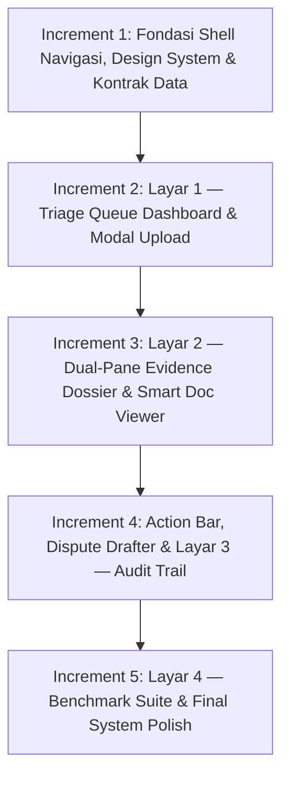

# 6 — Rencana Implementasi Bertahap (Incremental Build Plan)

**Tema Hackathon:** Detect Smarter, Protect JKN  
**Kategori:** Efisiensi Risiko Fasilitas Kesehatan (Kategori 3.1)  
**Dokumen Rujukan:**
- [`docs/3a-features.md`](file:///d:/Projects/Web%20Shi/healthkaton/docs/3a-features.md) (Spesifikasi Fitur F1–F10)
- [`docs/3b-end-to-end-flows.md`](file:///d:/Projects/Web%20Shi/healthkaton/docs/3b-end-to-end-flows.md) (Alur End-to-End & Golden Path)
- [`docs/5-ui-flow-and-task-plan.md`](file:///d:/Projects/Web%20Shi/healthkaton/docs/5-ui-flow-and-task-plan.md) (Task Plan & UI States)
- [`.agents/skills/ui-styling-and-design-guidelines.md`](file:///d:/Projects/Web%20Shi/healthkaton/.agents/skills/ui-styling-and-design-guidelines.md) (Panduan Styling Universal & Anti-Slop)

---

## 1. Prinsip Eksekusi Inkremental

Pengembangan sistem dilakukan melalui **5 Step Increment** berurutan. Setiap increment menerapkan siklus kerja standar:

$$\mathbf{Plan \rightarrow Review/Approve \rightarrow Execute/Build \rightarrow Verify \rightarrow Commit}$$

1. **Always Runnable & Buildable:** Setiap selesai sebuah increment, aplikasi wajib lolos kompilasi (`npm run build` dengan exit code 0) dan dapat dioperasikan langsung di browser tanpa state rusak.
2. **Kepatuhan Wajib Anti-Slop & Styling Guideline:**
   - **Tipografi:** Plus Jakarta Sans menyeluruh, `tabular-nums` untuk semua angka dan nomor referensi (tanpa font mono kaku).
   - **Palet Warna:** Dominan BPJS Green (`emerald-600/700`) dan BPJS Blue (`blue-600/700`). Warna amber/rose hanya untuk anomali atau peringatan riil.
   - **Bentuk:** Sudut persegi terkontrol (`rounded-[4px]`), tanpa bentuk pil (`no rounded-full`), tanpa titik bulat status (`no circular dots`), tanpa kickers/eyebrow text, dan tanpa border samping sepihak (`no border-left 3px`).
   - **Zero Compliance Theater:** Bebas dari jargon kepatuhan buatan (tanpa banner "BSrE-BSSN" atau chip "UU PDP Valid").
   - **Static Highlight:** Sorotan bukti rekam medis berlatar amber lembut statis (`bg-amber-100/80`), dilarang keras menggunakan animasi denyut (`no animate-pulse`).

---

## 2. Peta 5 Step Increment

---

## 3. Rincian Tiap Step Increment

### Increment 1: Fondasi Shell Navigasi, Design System & Kontrak Mock Data
- **Fokus:** Menyiapkan kerangka dasar aplikasi, navigasi antarmuka global, dan pipeline data mock terpusat.
- **Deliverables:**
  1. **Shell Navigasi Semantik (`ClarixSidebar` & `TopHeader`):**
     - Navigasi ke 4 rute utama: `/claims/triage`, `/claims/[id]/dossier`, `/claims/audit-trail`, dan `/benchmark/evaluation-suite`.
     - Layout responsive desktop/tablet dengan batas perimeter 1px bersih.
  2. **Kontrak Data TypeScript (`/types/`):**
     - Interface terpadu untuk `ClaimRecord`, `EvidenceFinding`, `ClinicalDocument`, `AuditTrailItem`, dan `BenchmarkResult`.
  3. **Mock Seed Store (`/data/claims-seed.ts`):**
     - Dataset 10–20 kasus klaim riil BPJS terstruktur (termasuk kasus unggulan bedah `#CLM-2026-089` dan kasus donor cloning `#CLM-2026-077`).
  4. **Auto-redirect:** Rute root `/` otomatis mengarah ke `/claims/triage`.
- **Kriteria Lolos (DoD):**
  - [x] `npm run build` sukses tanpa error TypeScript/Webpack (Next.js 15.5.28 production build).
  - [x] Navigasi sidebar berfungsi mulus berpindah antar-halaman.
  - [x] Seluruh data mock terpetakan sesuai skema data Dokumen 4.

---

### Increment 2: Layar 1 — Triage Queue Dashboard & Intake Modal (`/claims/triage`)
- **Fokus:** Ruang kerja antrean klaim terprioritaskan dan intake berkas klaim digital (Fitur F1, F2).
- **Deliverables:**
  1. **`MetricHeader`:** 3 kartu ringkasan operasional dengan tipografi Plus Jakarta Sans dan angka `tabular-nums` (*Antrean Telaah*, *Potensi Koreksi Tagihan*, *Klaim Lolos Cepat*).
  2. **`ClaimTable`:** Tabel antrean bergaya Attio:
     - Kolom: No SEP, Faskes, Diagnosis, Kode INA-CBG, Tag Anomali, Potensi Selisih Tarif, Aksi.
     - Diferensiasi tingkat risiko dan status berbasis ikon fungsional dalam kontainer persegi 4px (tanpa rainbow badge atau circular dot).
     - Filter interaktif: Dropdown faskes, tingkat risiko, dan modus anomali.
     - Klik baris memicu navigasi ke `/claims/:id/dossier`.
  3. **`ModalUploadClaim`:** Dropzone upload berkas klaim `.json` dengan visualisasi tahapan sanitasi PII dan validasi integritas skema.
- **Kriteria Lolos (DoD):**
  - [x] Triage table merender data mock secara presisi dengan sorting dan filtering aktif.
  - [x] Klik baris klaim berhasil membuka rute `/claims/:id/dossier`.
  - [x] Modal upload dapat dibuka-tutup dengan alur validasi visual yang bersih.

---

### Increment 3: Layar 2 — Dual-Pane Evidence Dossier & Smart Document Viewer (`/claims/:id/dossier`)
- **Fokus:** Ruang kerja telaah klinis verifikator (*The Core Golden Path*) untuk meninjau temuan AI terhadap dokumen asli rekam medis (Fitur F3, F4, F5, F6, F7, F8).
- **Deliverables:**
  1. **Layout Dual-Pane 50:50:**
     - Header metadata klaim faktual (No SEP, Pasien, RS Pengaju, Tanggal Masuk/Keluar, INA-CBG) tanpa jargon sertifikasi teatrikal.
  2. **Pane Kiri (Dossier Temuan):**
     - Kartu temuan terstruktur (`EvidenceCard`): Upcoding (F4), Inflated Alkes Stent (F5), Duplikasi Catatan SOAP (F6), dan Aturan Baku Deterministik (F3).
     - Kalkulator selisih tarif pasti (`TariffDeltaCalculator`) dengan angka `tabular-nums`.
     - Bagian *Alternative Explanations* untuk potensi non-fraud / salah koding administratif.
  3. **Pane Kanan (`SmartDocumentViewer`):**
     - Tab dokumen rekam medis (`Resume Medis`, `Laporan Operasi`, `CPPT`, `Hasil Lab`, `Billing`).
     - State aktif tab menggunakan *surface contrast*, tanpa border samping sepihak.
  4. **1-Click Verbatim Highlight:**
     - Mengklik tombol kutipan di kartu bukti memicu *smooth auto-scroll* ke posisi teks dokumen di pane kanan dan menyorot teks dengan penanda statis amber lembut (`bg-amber-100/80` bergaris batas 1px netral, **tanpa animasi berdenyut / strictly no pulse animation**).
- **Kriteria Lolos (DoD):**
  - [ ] Dual-Pane terpasang ergonomis dan responsif.
  - [ ] Interaksi 1-klik kutipan bukti berhasil menggulir dan menyorot teks pada dokumen yang tepat.
  - [ ] Lolos verifikasi anti-slop visual.

---

### Increment 4: Action Bar, Dispute Drafter & Layar 3 — Audit Trail (`/claims/audit-trail`)
- **Fokus:** Pengambilan keputusan final oleh verifikator (*Human-in-the-Loop*), pembuatan draf surat klarifikasi resmi ke RS, dan perekaman ke jejak audit permanen (Fitur F9).
- **Deliverables:**
  1. **`DossierActionBar`:**
     - 4 Tombol keputusan berbentuk persegi panjang terkontrol (`Setujui Klaim`, `Minta Konfirmasi RS`, `Koreksi Kode`, `Eskalasi Audit`).
  2. **`ModalDisputeLetter`:**
     - Form catatan wajib justifikasi verifikator.
     - Draf surat resmi klarifikasi BPJS otomatis berbasis temuan bukti dan klausul Permenkes No. 3/2023.
  3. **Sinkronisasi Status Klaim:**
     - Eksekusi persetujuan mengubah status klaim menjadi `SIAP_BAYAR`.
     - Eksekusi klarifikasi mengubah status klaim menjadi `PENDING_KLARIFIKASI_RS`.
  4. **Layar 3: Audit Trail Dashboard (`/claims/audit-trail`):**
     - Tabel log append-only kronologis: Stempel waktu, No SEP, Verifikator, Keputusan, Catatan Justifikasi, dan Aksi Pratinjau Surat.
     - Format angka referensi dengan `tabular-nums`, tanpa chip ornamen buatan.
- **Kriteria Lolos (DoD):**
  - [ ] Alur tertutup (*Closed-Loop Golden Path*) tuntas 100%: dari triage $\rightarrow$ dossier $\rightarrow$ ambil keputusan $\rightarrow$ tercatat di audit trail $\rightarrow$ antrean triage terbarui.

---

### Increment 5: Layar 4 — Scientific Benchmark Suite & Final Polish (`/benchmark/evaluation-suite`)
- **Fokus:** Halaman pembuktian ilmiah untuk dewan juri teknis dan audit kepatuhan desain final (Fitur F10).
- **Deliverables:**
  1. **Dashboard Benchmark (`/benchmark/evaluation-suite`):**
     - Panel kontrol eksekusi pengujian batch 30–50 dataset sintetis berlabel.
     - Kartu metrik performa objektif: Recall anomali ($\ge 85\%$), False Positive Rate ($\le 15\%$), Grounding Accuracy ($100\%$), Rata-rata Latensi ($<60$s).
     - Tabel perbandingan label ground truth vs prediksi sistem per kasus.
  2. **Final Polish & Verifikasi Kualitas:**
     - Audit antislop total: Memastikan nol dot bulat, nol pill badge, nol kickers, dan nol glowing neon di seluruh 4 layar.
     - Uji kontras warna dan keterbacaan tipografi.
     - Production build verification (`npm run build` bebas error).
- **Kriteria Lolos (DoD):**
  - [ ] Halaman benchmark dapat dijalankan secara instan untuk demonstrasi juri.
  - [ ] Seluruh 4 rute aplikasi berjalan mulus, kohesif, dan siap rilis.

---

## 4. Status Pelacak Implementasi (Implementation Tracker)

| Step | Deskripsi Increment | Rute Terkait | Status |
|---|---|---|---|
| **Increment 1** | Shell Navigasi, Design System & Kontrak Mock Data | `/`, Shell Global, `/types/` | `COMPLETED` |
| **Increment 2** | Layar 1: Triage Dashboard & Modal Upload | `/claims/triage` | `COMPLETED` |
| **Increment 3** | Layar 2: Dual-Pane Dossier & Document Viewer | `/claims/:id/dossier` | `READY TO START` |
| **Increment 4** | Action Bar, Dispute Drafter & Layar 3: Audit Trail | `/claims/audit-trail` | `PENDING` |
| **Increment 5** | Layar 4: Scientific Benchmark Suite & Final Polish | `/benchmark/evaluation-suite` | `PENDING` |
