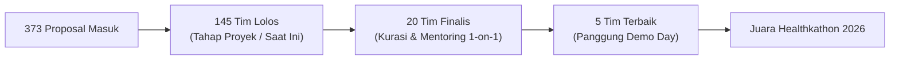

# Alur Kegiatan Healthkathon 2026

Dokumen ini merupakan transkripsi dan rangkuman komprehensif dari materi resmi panitia BPJS Kesehatan: **"Alur Kegiatan Healthkathon 2026 Ke Depan"** yang disampaikan oleh **Sandi Juniar** (Asisten Deputi Bidang Jaminan Kualitas TI BPJS Kesehatan / Ketua Panitia) pada tanggal **20 Oktober 2026** di bawah naungan Kedeputian Bidang Strategi, Perencanaan, dan Pengembangan TI.

---

## 1. Hasil Seleksi Proposal

Dari total **373 proposal** yang masuk dan dinilai oleh tim juri independen, panitia meloloskan **145 tim** ke tahap pengembangan proyek/prototype.

### Sebaran 145 Tim per Kategori
* **Fasilitas Kesehatan (FKTP & FKRTL):** 76% (mayoritas inovasi berfokus pada pencegahan *fraud*, efisiensi operasional, dan integrasi rekam medis/klaim).
* **Pemberi Kerja (Badan Usaha):** 16% (fokus pada kepatuhan kepesertaan dan iuran).
* **Peserta JKN:** 8% (fokus pada kemudahan akses, antrean, dan layanan preventif).

---

## 2. Funnel Tahapan Menuju Demo Day

* **Langkah Tim Saat Ini:** Mengembangkan ide proposal menjadi proyek atau prototipe yang fungsional, lalu mengumpulkan (*submit*) video presentasi dan demo aplikasi paling lambat **1 November 2026**.
* **Tahap Kurasi:** Dari seluruh proyek yang disubmit, panitia akan memilih **20 tim finalis** untuk mendapatkan program *one-on-one coaching* bersama mentor ahli.
* **Tahap Puncak:** Dari 20 finalis tersebut, akan dipilih **5 tim terbaik** untuk mempresentasikan karyanya secara langsung di hadapan dewan juri pada **Demo Day**.

---

## 3. Jadwal & Timeline Kegiatan (Oktober – November 2026)

### Fase Oktober 2026: Pengembangan & Submit
| Tanggal | Agenda | Keterangan |
|---|---|---|
| **19 Oktober** | Pembukaan Grup WhatsApp Peserta | Koordinasi resmi tim lolos seleksi dengan panitia |
| **20 Oktober** | Workshop Sistem Informasi JKN & Data Sample | Pemaparan arsitektur sistem, BEA, dan pembagian dataset sampel (14.00 WIB) |
| **21 Oktober** | Workshop Pendalaman Solusi Berbasis AI | Bersama narasumber ahli kecerdasan buatan (09.30 WIB via Zoom) |
| **21–30 Oktober** | Workshop Lanjutan Expert AI *(Tentatif)* | Sesi pengayaan teknis implementasi AI/ML untuk Healthkathon |
| **1 November** | **Tenggat Utama: Batas Submit Video & Demo** | Batas akhir pengunggahan tautan video presentasi & prototipe di dashboard |

### Fase November 2026: Kurasi, Mentoring & Final *(Tentatif)*
| Tanggal | Agenda | Keterangan |
|---|---|---|
| **2–4 November** | Kurasi 20 Tim Finalis | Penilaian oleh panitia terhadap seluruh proyek yang disubmit |
| **5–13 November** | Coaching One-on-One | Sesi pembinaan intensif (4 dosen mentor × 5 tim = 20 tim, minimal 2 sesi daring) |
| **14–15 November**| Pengumpulan Proyek Final Finalis | Finalisasi prototipe dan slide presentasi pasca-mentoring |
| **16–17 November**| Seleksi Penentuan 5 Tim Terbaik | Kurasi penentu tim yang berhak melaju ke Demo Day |
| **21 November** | **Demo Day & Penjurian Final (Sabtu)** | Presentasi langsung 5 tim di hadapan Dewan Juri tingkat nasional |

---

## 4. Empat Hal yang Perlu Ditindaklanjuti Peserta

1. **Gabung Grup WhatsApp:** Tautan undangan dikirimkan ke email ketua tim mulai 19 Oktober 2026. Seluruh pengumuman resmi disalurkan melalui grup ini.
2. **Ikuti Workshop:**
   * *20 Okt (14.00 WIB):* Alur proses SI Program JKN & pemanfaatan data sample.
   * *21 Okt (09.30 WIB) & lanjutan:* Pendalaman solusi berbasis AI bersama pakar industri.
3. **Kembangkan Prototype:** Mewujudkan ide dari proposal menjadi aplikasi atau sistem demo yang nyata, fungsional, dan memberikan dampak terukur.
4. **Submit di Dashboard:** Mengunggah tautan video presentasi dan demo aplikasi paling lambat **1 November 2026**.

---

## 5. Panduan Pembuatan Video Proyek

Panitia menetapkan struktur rekomendasi agar materi presentasi mudah dinilai secara objektif:

### Struktur Rekomendasi Video (Maksimal 10 Menit):
1. **Perkenalan Tim:** Foto dan perkenalan seluruh anggota tim.
2. **Identitas Ide:** Judul ide/solusi, deskripsi singkat, dan tujuan utama.
3. **Latar Belakang & Dampak:** Masalah nyata yang diselesaikan beserta bukti data dan indikator dampak terukur.
4. **Alur Proses Aplikasi:** Diagram alir sistem dari data input, pemrosesan, analisis AI, hingga output aksi.
5. **Demo Aplikasi / Prototype:** Demonstrasi antarmuka dan interaksi nyata sistem yang sedang berjalan.
6. **Penjelasan Fitur Utama:** Rincian kapabilitas modul dan pemecahan masalahnya.
7. **Slide Tambahan (Bila Perlu):** Arsitektur teknis, tata kelola keamanan/privasi, atau rencana implementasi.

### Ketentuan Teknis Video:
* **Durasi Maksimal:** 10 menit (video melebihi durasi berpotensi terkena penalti).
* **Alat Perekaman:** Disarankan menggunakan fitur rekaman *Zoom Meeting* (rekaman slide + webcam pemapar).
* **Media Publikasi:** Diunggah ke platform YouTube dengan setelan visibilitas **"Unlisted"** (tidak publik, hanya yang memiliki tautan).
* **Kanal Pengumpulan:** Tautan YouTube disubmit melalui Dashboard resmi Healthkathon.

---

## 6. Kriteria Penilaian Proyek

Pengembangan solusi dinilai berdasarkan 5 pilar utama:

| Pilar Penilaian | Deskripsi dan Fokus Evaluasi |
|---|---|
| **1. Kreativitas & Keunikan** | Pendekatan inovatif berbasis AI/ML (misal: GenAI, NLP, *Computer Vision*, *Graph AI*) yang memberikan kebaruan nyata dibanding solusi konvensional atau sistem eksisting BPJS Kesehatan. |
| **2. Model Bisnis & Keberlanjutan** | Solusi memiliki kelayakan implementasi praktis dan dapat direplikasi secara berkelanjutan di seluruh fasilitas kesehatan/wilayah Indonesia. |
| **3. Dampak Terukur** | Memiliki indikator kuantitatif yang jelas terhadap pencegahan *fraud* klaim, efisiensi anggaran JKN, percepatan waktu pelayanan, atau peningkatan kepuasan peserta. |
| **4. Presentasi & Komunikasi** | Kemampuan tim menyajikan ide, fungsionalitas produk, dan dampak solusi secara runtut, ringkas, jelas, serta penguasaan materi yang matang. |
| **5. Kesiapan Produk** | Kematangan fungsional prototipe (*working software*), kualitas pengalaman pengguna (UX/UI), keandalan teknis, dan efisiensi operasional sistem. |

---

## 7. Enam Prinsip Selama Masa Pengembangan

1. **Karya Orisinal:** Proyek yang dikembangkan adalah karya asli dari tim yang bersangkutan dan konsisten dengan proposal yang telah dinyatakan lolos.
2. **Anggota Tim Tetap:** Komposisi anggota tim tidak diperkenankan berubah; setiap penyesuaian khusus harus dikoordinasikan secara tertulis dengan panitia.
3. **Pemanfaatan Data Sample:** Dataset sampel yang dibagikan oleh BPJS Kesehatan hanya boleh digunakan secara eksklusif untuk kepentingan kompetisi Healthkathon dan dilarang disebarluaskan ke luar lingkungan tim.
4. **Perlindungan Data Pribadi (UU PDP):** Dilarang keras menggunakan data riil peserta JKN yang memuat informasi identitas pribadi (*Personally Identifiable Information* - PII) atau rekam medis riil tanpa otorisasi resmi.
5. **Patuhi Jadwal:** Disiplin terhadap tenggat waktu pengumpulan proyek final pada **1 November 2026**.
6. **Komunikasi Santun:** Menjaga etika, profesionalitas, dan tata tertib dalam berkomunikasi di kanal resmi WhatsApp maupun saat sesi workshop/mentoring.

---

## 8. Kanal Komunikasi Resmi

* **Grup WhatsApp Peserta:** Saluran utama pengumuman ketentuan lomba, jadwal acara, penjelasan alur SI JKN, dan distribusi data sampel.
* **Dashboard Healthkathon:** Portal unduh template presentasi resmi dan formulir pengunggahan tautan video/demo (aktif 19 Oktober s.d. 1 November 2026).
* **Narahubung Panitia:** Khusus penanganan kendala teknis dashboard atau urusan administratif resmi tim.
