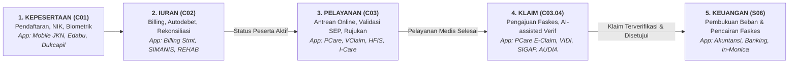

# Materi Workshop Healthkathon 2026: Sistem Layanan JKN & Pemanfaatan AI BPJS Kesehatan

Dokumen ini merupakan transkripsi dan rangkuman komprehensif dari materi workshop resmi: **"Sistem Layanan JKN & Pemanfaatan AI BPJS Kesehatan"** yang dipresentasikan oleh **Wahyu Satriyo Wibowo** (Sistem Analis BPJS Kesehatan, Kedeputian Bidang SPPTI) pada tanggal **20 Oktober 2026** di hadapan para peserta Healthkathon 2026.

---

## 1. Sekilas Tentang BPJS Kesehatan & Skala Operasional JKN

### Profil Skala Nasional JKN (Data per September 2026)
* **Cakupan Penduduk Indonesia:** 290.125.073 jiwa (negara terpadat ke-4 di dunia, 17.380 pulau, 652 bahasa daerah, 1.332 suku bangsa).
* **Cakupan Kepesertaan JKN (*Universal Health Coverage* - UHC):** **284,4 Juta jiwa (98,02%)** dari total penduduk.
* **Fasilitas Kesehatan Mitra:** **+34.217 Faskes** yang terdiri dari:
  * FKTP (Fasilitas Kesehatan Tingkat Pertama): 23.816 faskes (Puskesmas, Klinik Pratama, Dokter Praktik Mandiri).
  * FKRTL (Fasilitas Kesehatan Rujukan Tingkat Lanjut): 3.221 Rumah Sakit.
  * Sarana Penunjang (Apotek, Laboratorium, Optik): 7.180 unit.
* **Infrastruktur Layanan:** 128 Kantor Cabang, 388 Kantor Kabupaten/Kota, 10.161 Pegawai BPJS Kesehatan (rasio beban: 1 pegawai melayani ~27.173 peserta).
* **Kanal Pembayaran Premi:** +955.000 hingga 1 Juta *Payment Points* (Bank Himbara, Bank Swasta, Minimarket Retail, Fintech/E-Commerce).
* **Beban Transaksi Sistem:** Mencapai **1.700 transaksi per detik (*transactions per second*)**.

### Kelembagaan & Batasan Kewenangan (UU No. 24 Tahun 2011)
* **Kedudukan:** Badan Hukum Publik (bukan Badan Usaha Milik Negara/BUMN) yang bertanggung jawab **langsung kepada Presiden Republik Indonesia**, bukan di bawah kementerian tertentu.
* **Peran Sisi Permintaan (*Demand Side*):** BPJS Kesehatan bertugas mengelola kepesertaan, mengumpulkan iuran, mengelola dana jaminan sosial, dan membiayai **Upaya Kesehatan Perseorangan (UKP)**.
* **Peran Sisi Pasokan (*Supply Side*):** Pemenuhan sarana fisik faskes, distribusi tenaga medis, dan **Upaya Kesehatan Masyarakat (UKM)** merupakan domain Kementerian Kesehatan dan Pemerintah Daerah.
* **Tugas Pokok Berdasarkan UU 24/2011 Pasal 10:** Pendaftaran peserta, pengumpulan iuran, pengelolaan dana jaminan sosial, pembiayaan/pembayaran manfaat pelayanan kesehatan, dan penyampaian informasi program jaminan sosial.

### Kinerja Teknologi Informasi (Semester I/2026)
* **Ketersediaan Sistem (*System Availability*):** **99,998%** (standar COBIT 2019, ISO 27001, ISO 27701, ISO 20000, ISO 9001).
* **Penyelesaian Insiden/Keluhan TI:** **96,86%**.
* **Keamanan Siber:** Berhasil memblokir **10,4 juta ancaman siber**.
* **Realisasi AI & RPA:** Telah mencapai **85%** dari target Renstra TI Semester I/2026.
* **Interoperabilitas K/L Aktif:** 
  * *Kemenkes:* Uji coba integrasi data insentif KBK & NHA, RBKP-PCare, CKG-PCare, RME-VClaim, KFA-Apotek (SatuSehat).
  * *Polri:* Uji coba integrasi status keaktifan kepesertaan JKN untuk syarat penerbitan SIM.
  * *Kemenkop:* Sinkronisasi data peserta JKN untuk Koperasi Desa Merah Putih.

---

## 2. Evolusi Digitalisasi BPJS Kesehatan Menuju Intelligence Transformation

Evolusi TI BPJS Kesehatan bergerak melalui 3 era besar:

1. **Era Digitalisasi (Mulai 2014):**
   * *Digitization (Konversi Fisik ke Digital):* Registrasi digital, eligibilitas peserta, surat elektronik, KIS Digital di Mobile JKN, entri obat faskes.
   * *Digitalization (Penyederhanaan Proses Bisnis):* Mobile JKN *cashless*, verifikasi klaim otomatis, autodebet iuran, Dashboard *Business Intelligence* (BI).
2. **Era Transformasi Digital (Mulai 2021):**
   * Antrean online terintegrasi di faskes, penghentian dokumen fisik (*paperless*), pemanfaatan IoT (*BUGAR*), telemedisin, big data analitik prediktif, i-Care JKN, dan penyediaan *data sample* penelitian.
   * Interoperabilitas sistem dengan >32 Kementerian/Lembaga negara.
3. **Era Intelligence Transformation (Mulai 2024–Kini):**
   * Fokus utama pada pemanfaatan **AI, Machine Learning, Large Language Models (LLM), Computer Vision, Deep Learning, dan Robotic Process Automation (RPA)** untuk otomasi pengambilan keputusan dan layanan personal adaptif.

---

## 3. Arsitektur Enterprise (BEA) & Alur Sistem End-to-End

BPJS Kesehatan mengadopsi kerangka kerja **Business Enterprise Architecture (BEA)** untuk mengonsolidasi lebih dari **100+ aplikasi live** menjadi **5–10 klaster sistem makro** berbasis *Single Source of Truth*.

### Portofolio Proses Bisnis Makro (BEA)
```
┌─────────────────────────────────────────────────────────────────────────────┐
│ CORE BUSINESS PROCESSES                                                     │
│ • C01: Manajemen Kepesertaan (32 aplikasi aktif)                            │
│ • C02: Manajemen Kolektibilitas / Iuran (12 aplikasi aktif)                 │
│ • C03: Jaminan Pelayanan Kesehatan (30 aplikasi aktif)                      │
│   └── C03.04: Pengelolaan Klaim Faskes                                      │
├─────────────────────────────────────────────────────────────────────────────┤
│ MANAGEMENT & SUPPORT                                                        │
│ • Manage (M01-M07): Strategi, Risiko, Audit, Aktuaria, TI, Data & Informasi │
│ • Support (S01-S06): SDM, Sarana, Riset, Mitra, Keuangan (S06)              │
│ (Total 85 aplikasi aktif Manage & Support)                                  │
└─────────────────────────────────────────────────────────────────────────────┘
```

### Benang Merah Alur Sistem End-to-End
Hubungan berantai antar-modul inti BPJS Kesehatan:



> **Aturan Bisnis Utama (*Golden Rule*):**
> * Status aktif peserta (`C01` + kelancaran iuran `C02`) menentukan keabsahan eligibilitas pelayanan kesehatan (`C03`).
> * Berkas pelayanan yang selesai di faskes diterbitkan klaimnya melalui `C03.04` (diverifikasi berbantuan AI seperti VIDI).
> * Berkas klaim yang disetujui bermutasi menjadi pengakuan beban dan dieksekusi pembayarannya oleh divisi Keuangan (`S06`).

---

## 4. Arah Strategis TI 2026–2031 & Inisiatif Kunci

Empat pilar tema strategis TI BPJS Kesehatan:
1. **Simple:** Simplifikasi dan modernisasi aplikasi, pemangkasan redundansi sistem, adopsi *agile delivery*.
2. **Integrated:** Interoperabilitas menyeluruh antarsistem faskes dan K/L; mewujudkan *Satu Data Jaminan Sosial*.
3. **Intelligent:** Penerapan *Enterprise AI*, automasi robotik (RPA), dan analitik prediktif untuk layanan yang proaktif dan presisi.
4. **Resilient:** Ketersediaan infrastruktur 24/7, pertahanan keamanan siber kelas tinggi, dan tata kelola kepatuhan regulasi.

### Empat Inisiatif Kunci (2026–2027)
* **Smart Claim × RME-TTE:** Integrasi penagihan klaim berbasis Rekam Medis Elektronik (RME) yang dilengkapi Tanda Tangan Elektronik tersertifikasi (PSrE-BSSN) dan tanda keabsahan *TrustMark*.
* **Enterprise AI & JKN Data Hub:** Pembangunan kapabilitas *Enterprise AI* berskala modular/swarm, Dashboard Eksekutif Real-Time 360°, dan portal analisis data interaktif.
* **Microservices & Single Source of Truth:** Transformasi arsitektur ke *API management & event-driven architecture*, standarisasi *Master Data Management*, serta peluncuran Playbook & Sandbox API terintegrasi.
* **Tata Kelola TI, Data & AI:** Penyelarasan arsitektur BEA, standardisasi kamus data (*data glossary*), kepatuhan UU PDP (dokumen ROPA & DPIA), dan etika tata kelola model AI.

---

## 5. Portofolio Solusi AI yang Sudah Berjalan di BPJS Kesehatan

BPJS Kesehatan telah mengimplementasikan berbagai varian AI dalam operasional produksi:

### 1. Computer Vision & Biometrik
* **FRISTA (*Face Recognition* Eligibilitas Peserta):** 
  * Telah diimplementasikan di **2.348 Rumah Sakit**.
  * Berfungsi sebagai validasi biometrik wajah peserta di admisi RS (menggantikan atau melengkapi verifikasi sidik jari/fingerprint).
  * Memungkinkan penerbitan Surat Eligibilitas Peserta Elektronik (**E-SEP**) tanpa kewajiban tanda tangan fisik oleh pasien di loket.

### 2. Generative AI & Large Language Models (LLM)
* **JAPRI (*JKN Assistant Platform Intelligence*):** 
  * Asisten AI berbasis arsitektur *Retrieval-Augmented Generation* (RAG).
  * Pengguna mengajukan pertanyaan -> sistem melakukan pencarian semantik (*smart lookup*) pada basis data pengetahuan resmi BPJS Kesehatan (*specific knowledge base*) -> LLM menghasilkan jawaban kontekstual yang akurat berdasarkan dokumen rujukan.
* **Human AI (Digital Human "Vira" di Mobile JKN):** 
  * Karakter AI interaktif untuk konsultasi awal, verifikasi identitas, dan navigasi layanan bagi peserta.
  * Mencapai 2.022 pengguna dengan 3.188 sesi percakapan dan rata-rata durasi interaksi 10 menit 8 detik.

### 3. Robotic Process Automation (RPA) & Automasi Cerdas
* **RPA Klaim Koreksi & Pembayaran:** Telah diimplementasikan *live* secara nasional untuk mengotomasi verifikasi administratif rutin.
* **AI-Based Push Notification Mobile JKN:** 
  * Menggunakan pemodelan prediktif untuk personalisasi pengiriman notifikasi pengingat iuran dan informasi layanan.
  * **Hasil lompatan performa:** Sebelum adopsi AI, pengiriman 51 juta notifikasi membutuhkan waktu **71 hari** (dengan *success rate* hanya 0,12%). Setelah implementasi AI, pengiriman 51 juta notifikasi diselesaikan dalam waktu **17 jam (100× lebih cepat)**.

### 4. Verifikasi Klaim Berbantuan AI
* **VIDI (Verification Digital):** Sistem pendeteksi ketidaksesuaian berkas klaim digital FKRTL.
* **Smart Vedika:** Tahap uji coba (*piloting*) di 12 RS rujukan; terhubung dengan 2.025 FKRTL yang telah mengimplementasikan RME dan integrasi sistem i-Care.

### 5. Big Data Platform & Analitik Terfavorit
* Menggunakan Cloudera Data Platform, Talend ETL/ELT (*real-time & batch*), dan Voltage untuk penyamaran data pribadi (*tokenisasi/enkripsi*).
* Digunakan oleh **5.354 pengguna internal** dengan **4,04 juta total akses** pada Semester I/2026 (56,87% diakses di luar jam kerja).
* **Top 5 Dashboard Paling Favorit:**
  1. *Monitoring Verifikasi Klaim:* 10,2 juta akses.
  2. *Monitoring P3T (Telekolekting Iuran):* 6,0 juta akses.
  3. *Pemanfaatan Antrean Online FKTP:* 5,6 juta akses.
  4. *Overview Antrean FKRTL:* 3,9 juta akses.
  5. *Capaian UHC:* 3,7 juta akses.

---

## 6. Tantangan Riil JKN 2026: Masalah Utama yang Harus Dijawab Inovasi

Panitia memaparkan data statistik empiris yang menjadi latar belakang penyelenggaraan Healthkathon:

### 1. Jurang Defisit Keuangan & Rasio Klaim
* **Total Penerimaan Iuran:** **Rp118 Triliun** (per Semester/MTR 2026).
* **Total Pembayaran Klaim Layanan:** **Rp132 Triliun**.
* **Defisit / Kesenjangan:** Terjadi selisih pembiayaan sebesar **Rp14 Triliun**.
* Pemerintah telah menyiapkan dana talangan tambahan sebesar Rp20 Triliun (September 2026) untuk menjaga kelancaran likuiditas kas, pembayaran klaim faskes, serta penertiban data kepesertaan PBI (DTSEN).
* *Pesan Kunci untuk Inovasi AI/ML:* Diperlukan solusi **kendali mutu dan kendali biaya (*cost containment*)**, pencegahan klaim ganda, dan **deteksi kecurangan (*fraud*)** pada proses verifikasi klaim rumah sakit.

### 2. Lonjakan Keluhan Peserta & Antrean Faskes
* Tercatat **97.798 pengaduan peserta** sepanjang Januari–Agustus 2026.
* Keluhan terhadap penumpukan antrean layanan di faskes meningkat dari 29,1% (Februari) menjadi **36,6% (Agustus)** — tertinggi sepanjang tahun.
* **28.397 keluhan** terpusat pada kendala operasional aplikasi Mobile JKN:
  * *Kendala antrean (11.697 aduan):* Gangguan koneksi bridging sistem rumah sakit (HFIS) sebesar 27,8%, serta kendala ambil/batal/reschedule jadwal sebesar 26,2%.
  * *Kendala akses/registrasi (10.663 aduan):* Pembuatan akun baru (34,2%), keterlambatan pengiriman kode OTP (22,4%), kegagalan login (16,5%).
  * *Fitur tidak dapat diakses (6.037 aduan):* Lupa/reset password akun (35,1%).

---

## 7. Peta Peluang AI & ML di Healthkathon 2026 (Berdasarkan Modul BEA)

Panitia mengidentifikasi peluang implementasi AI/ML yang selaras dengan arsitektur resmi:

| Modul BEA | Area Bisnis | Contoh Peluang *Use Case* AI / ML | Titik Integrasi Aplikasi Eksisting | Teknik AI / Algoritma yang Relevan |
|---|---|---|---|---|
| **C01** | Kepesertaan | Deteksi data kepesertaan anomali/ganda, verifikasi biometrik, asisten virtual layanan peserta | Aplikasi Kepesertaan, FRISTA, Mobile JKN, PANDAWA | *Entity resolution, Computer Vision, LLM* |
| **C02** | Iuran | Prediksi risiko gagal bayar / tunggakan, personalisasi strategi tele-kolekting | Billing Statement, Kanal Pembayaran, Autodebet, SIMANIS | Klasifikasi risiko, *Propensity scoring* |
| **C03** | Pelayanan | Prediksi lonjakan antrean loket/poli, peramalan ketersediaan tempat tidur RS, triase keluhan pasien | Antrean Online, Aplicares, HFIS, SIPP | *Time-series forecasting, NLP sentiment analysis* |
| **C03.04** | **Klaim Faskes** | **Deteksi pola *fraud*, anomali *coding* (upcoding/unbundling), ekstraksi otomatis dokumen Rekam Medis Elektronik (RME)** | **VClaim, VIDI, SIGAP, AUDIA, Dashboard EMR** | ***Anomaly detection, Graph Neural Networks, Document AI / Vision LLM*** |
| **C03 · IoT** | Preventif | Analisis kesehatan personal, pendeteksi risiko penyakit kronis, pengingat minum obat adaptif | Aplikasi BUGAR, Skrining Riwayat Kesehatan, Mobile JKN | *Time-series analysis*, Sistem Rekomendasi |
| **S06 · M05** | Keuangan & Aktuaria | Simulasi proyeksi rasio klaim vs pendapatan iuran, kueri analitik berbasis bahasa alami | Sistem Prediksi, DAMAI, Dashboard BI, Big Data Hub | *Actuarial modeling, Text-to-SQL, Generative AI* |

---

## 8. Prinsip Solusi AI & Tata Kelola (*Governance & Ethics*)

Solusi AI yang diajukan dalam Healthkathon wajib mematuhi panduan tata kelola berikut:

### Enam Prinsip Solusi AI Healthkathon
1. **Masalah Nyata & Terukur:** Memiliki target Key Performance Indicator (KPI) yang jelas (misal: pemangkasan durasi verifikasi klaim, kenaikan akurasi deteksi anomali berkas, penurunan angka tunggakan).
2. **Terpetakan ke BEA:** Menyebutkan secara eksplisit modul proses bisnis (`C01`, `C02`, `C03`, `C03.04`, atau `S06`) serta aplikasi eksisting BPJS Kesehatan yang dihubungkan.
3. **Keamanan & Perlindungan Data:** Menggunakan data sintetis, *sandbox*, atau *tokenized dummy data*. Dilarang keras mengirimkan data riil peserta ke layanan API AI publik.
4. **Human-in-the-Loop:** Keputusan krusial (terutama terkait penolakan klaim atau status kepesertaan) tidak boleh diputuskan 100% secara otonom oleh AI; AI bertindak sebagai *decision support co-pilot*, dan model harus memiliki kemampuan penjelasan (*explainable AI / auditability*).
5. **Adil & Bebas Bias:** Algoritma harus diuji agar tidak memunculkan bias diskriminatif antar-segmen peserta (PBI vs Non-PBI) maupun disparitas fasilitas kesehatan antar-wilayah.
6. **Siap Produksi (*Production-Ready*):** Dirancang dengan arsitektur *API-first*, berbentuk modul/layanan mikro yang terisolasi, serta dilengkapi mekanisme pemantauan kinerja model (*model drift & latency monitoring*).

### Empat Aturan Cek Sebelum Menggunakan Model AI (4 Cek AI)
1. **Cek Data:** Apakah data input mengandung rekam medis, NIK, atau identitas pribadi peserta? Jika **YA**, dilarang diproses melalui penyedia model AI pihak ketiga/publik; wajib menggunakan infrastruktur inferensi lokal/internal terenkripsi.
2. **Cek Akun:** Wajib menggunakan lisensi API atau akun *enterprise* resmi yang memiliki jaminan *zero data retention*, bukan akun publik gratis/berbagi.
3. **Cek Kontrol:** Pastikan opsi pelatihan data (*model training opt-out*) diaktifkan agar data transaksi sistem tidak digunakan untuk melatih model pihak ketiga.
4. **Cek Keluaran (*Output*):** Seluruh output prediksi, rekomendasi klinis, atau skor risiko wajib dapat diverifikasi oleh verifikator manusia sebelum tindakan eksekusi dilakukan.

> **Landasan Regulasi Kepatuhan:**
> * Undang-Undang No. 27 Tahun 2022 tentang Perlindungan Data Pribadi (UU PDP).
> * Peraturan Direksi BPJS Kesehatan No. 09 Tahun 2024 tentang Tata Kelola Kecerdasan Artifisial.
> * Surat Edaran Menteri Komunikasi dan Informatika No. 09 Tahun 2023 tentang Etika Kecerdasan Artifisial.
