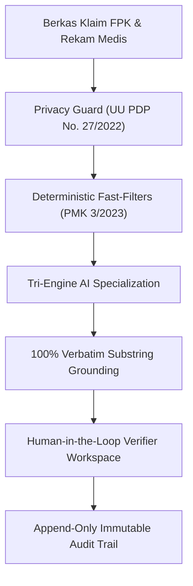
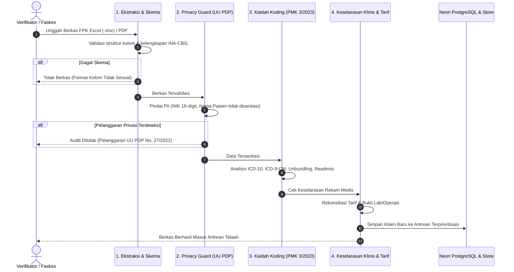
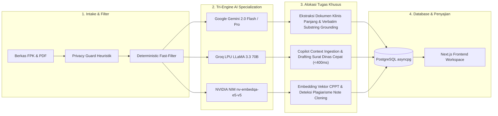

# TELISIK (Powered by Clarix AI)
## Dokumentasi Teknis Spesifikasi Fitur, Halaman, dan Arsitektur Sistem

Dokumen ini merupakan panduan arsitektur dan spesifikasi teknis lengkap untuk platform **TELISIK (Powered by Clarix AI)**. Dokumen ini mencakup pemetaan seluruh halaman aplikasi (*site architecture*), alur navigasi, bedah fungsionalitas setiap komponen UI, mekanisme inferensi kecerdasan buatan (*Tri-Engine AI*), pipeline validasi berkas, kepatuhan mediko-legal, hingga skema model data.

---

## 1. Ringkasan Eksekutif & Identitas Platform

### 1.1 Profil Sistem
- **Nama Platform:** TELISIK (*Teknologi Evaluasi & Litigasi Investigasi Selisih Klaim*)
- **Sub-sistem / AI Engine:** Clarix AI Copilot & Scientific Reasoning Engine
- **Kategori Healthkathon 2026:** Kategori 3.1 — *Efisiensi Risiko Fasilitas Kesehatan (Tata Kelola Klaim JKN, Anti-Fraud, & Rekonsiliasi Tarif)*
- **Pengguna Sasaran:** Dokter Verifikator BPJS Kesehatan (Kantor Cabang Utama / KCU JKN), Tim Pencegahan Kecurangan JKN (PK-JKN), Manajemen Faskes, dan Auditor Mediko-Legal.

### 1.2 Masalah Pokok yang Ditangani
Dalam operasional verifikasi klaim pra-bayar (*pre-payment verification*) faskes rujukan tingkat lanjut (FKRTL), terdapat lima modus utama pembengkakan biaya dan anomali koding yang membebani dana jaminan sosial kesehatan (DJS):
1. **Upcoding Tingkat Keparahan / Komplikasi:** Menambahkan diagnosis sekunder komplikasi berat (seperti *Sepsis A41.9*) tanpa dukungan bukti biomarker objektif (leukosit normal, prokalsitonin $< 0.5\text{ ng/mL}$) untuk menaikkan severity level paket INA-CBG dari Level I ke Level III.
2. **Penggelembungan Biaya Alkes / Implan (*Inflated Bills*):** Menagihkan 2 unit *Drug-Eluting Stent* (DES) atau implan ortopedi pada kuitansi farmasi faskes, sementara lembar laporan operasi dokter operator membuktikan hanya 1 unit yang terpasang di meja bedah (1 unit lainnya batal dipasang dan dikembalikan ke depo).
3. **Pemecahan Prosedur Terlarang (*Unbundling*):** Menagihkan tindakan penunjang (misal kateterisasi jantung diagnostik atau pemasangan drain) secara terpisah di luar paket INA-CBG yang seharusnya sudah inklusif sesuai Permenkes No. 3 Tahun 2023.
4. **Duplikasi Redaksional Rekam Medis (*Note Cloning / Plagiarisme CPPT*):** Menggandakan narasi catatan perkembangan pasien terintegrasi (SOAP) dari berkas pasien historis dengan kemiripan semantik $>90\%$ tanpa asesmen fisik aktual.
5. **Readmisi Berulang Terfragmentasi ($\le 30\text{ Hari}$):** Memulangkan pasien lebih cepat untuk kemudian dirawat kembali dalam interval 15–20 hari pada diagnosis yang sama oleh DPJP yang sama guna menghasilkan dua nomor SEP klaim terpisah.

### 1.3 Tiga Pilar Paradigma Solusi


1. **Human-in-the-Loop Decision:** AI tidak pernah mengambil keputusan pembayaran sepihak; Clarix AI bertindak sebagai asisten investigasi yang menyajikan ringkasan anomali, kalkulasi selisih tarif, dan rekomendasi putusan. Verifikator medis manusia yang memvalidasi dan menandatangani putusan.
2. **100% Verbatim Substring Grounding (Anti-Halusinasi):** Setiap temuan anomali wajib terikat (*grounded*) pada kutipan teks harfiah yang dapat diverifikasi langsung pada dokumen asli PDF rekam medis faskes. Jika tidak ada kutipan teks pasti, temuan dianulir.
3. **Kepatuhan Mediko-Legal Baku:** Setiap putusan bermuara pada penerbitan Surat Dinas Resmi berstandar tata naskah dinas BPJS Kesehatan lengkap dengan nomor surat, dasar hukum PMK 3/2023, dan pencatatan riwayat permanen (*append-only*).

---

## 2. Peta Navigasi & Arsitektur Routing Aplikasi

Aplikasi dibangun menggunakan **Next.js 14+ App Router** dengan rute-rute utama sebagai berikut:

| Rute URL | Nama Halaman | Fungsi & Peran Utama | File Sumber |
| :--- | :--- | :--- | :--- |
| `/` | *Root Redirect* | Mengarahkan otomatis pengguna langsung ke antrean triase klaim. | `app/page.tsx` |
| `/claims/triage` | **Triase & Antrean Klaim** | Papan kerja utama antrean klaim pra-bayar, filter risiko, sorting prioritas, metrik efisiensi, dan intake berkas FPK. | `app/claims/triage/page.tsx` |
| `/claims/[id]/dossier` | **Ruang Telaah Berkas & Investigasi Mediko-Legal** | Ruang investigasi mendalam berkas per pasien, penyorot PDF interaktif, kalkulator tarif INA-CBG, dan eksekusi putusan dinas. | `app/claims/[id]/dossier/page.tsx` |
| `/claims/audit-trail` | **Audit Trail & Arsip Putusan** | Buku besar riwayat putusan permanen (*append-only*), pencetakan naskah dinas, dan ekspor berita acara rekonsiliasi klaim. | `app/claims/audit-trail/page.tsx` |
| `/benchmark` | **Scientific Benchmark Launcher** | Peta interaktif faskes Jabodetabek, penentuan ambang batas evaluasi (*recall* & *FPR*), dan peluncur batch uji validasi model. | `app/benchmark/page.tsx` |
| `/benchmark/evaluation-suite` | **Benchmark Evaluation Suite** | Eksekusi batch uji akurasi AI, Confusion Matrix interaktif, verifikasi verbatim rate, dan analisis *false positive/negative*. | `app/benchmark/evaluation-suite/page.tsx` |
| `/intelligence` | **Clarix AI Studio** | Ruang analisis penalaran makro-regulasi, audit komparasi antar-faskes, perbandingan tren alkes, dan konsultasi interaktif regulasi. | `app/intelligence/page.tsx` |

---

## 3. Bedah Lengkap Fitur per Halaman

### 3.1 Halaman 1: Triase & Antrean Klaim (`/claims/triage`)

Halaman triase berfungsi sebagai filter garis depan (*first line of defense*) verifikator BPJS. Di halaman ini, tumpukan berkas klaim rumah sakit yang masuk dipindai secara otomatis, dihitung bobot risikonya, dan disusun berdasarkan tingkat urgensi potensi kebocoran dana JKN.

```
+--------------------------------------------------------------------------------------------------------+
| TOP HEADER: TELISIK BPJS | dr. Siti Aminah (Verifikator Utama) | Status Server: Online | Jam Kerja WIB  |
+--------------------------------------------------------------------------------------------------------+
| METRIC ROW:                                                                                           |
| [ Card 1: Antrean Telaah Klaim ] [ Card 2: Potensi Koreksi Tagihan ] [ Video Hero Loop (hero.webm) ]    |
+--------------------------------------------------------------------------------------------------------+
| FILTER TOOLBAR:                                                                                        |
| [Cari No SEP / RS / Diagnosis / INA-CBG] [Filter Risiko] [Filter Faskes] [Filter Status] [Urutkan]   |
+--------------------------------------------------------------------------------------------------------+
| CLAIM TABLE:                                                                                           |
| ID Klaim & Faskes | Pasien & DPJP | Diagnosis & INA-CBG | Indikasi Anomali | Potensi Selisih | Aksi    |
| CLM-2026-089 ...   | 58th L        | I21.0 / I-4-10-III  | Upcoding Sepsis  | Rp 24.900.000   | [Buka]  |
+--------------------------------------------------------------------------------------------------------+
```

#### Fitur & Komponen Kunci:
1. **Header Metrik & Hero Animasi (`MetricHeader.tsx`):**
   - **Kartu Antrean Masuk:** Menampilkan total berkas yang memerlukan telaah aktif lengkap dengan visual dokumen 3D.
   - **Kartu Potensi Koreksi Tagihan:** Mengagregasi total selisih rupiah yang berhasil diidentifikasi sebelum pembayaran dilakukan (misal Rp 48.800.000).
   - **Video Animasi Verifikator Medis:** Video hero interaktif (`hero.webm`) dengan transisi crossfade seamless loop dan CSS gradient mask pada tepian video untuk integrasi visual dengan layout.
2. **Filter & Pencarian Multi-Kriteria (`ClaimFilterBar.tsx`):**
   - **Omnibox Search:** Pencarian cepat instan (*real-time debounce*) berdasarkan ID Berkas (misal `CLM-2026-089`), Nama Rumah Sakit, Nama Diagnosis, Kode ICD-10, atau Kode INA-CBG.
   - **Filter Tingkat Risiko:** Tab toggle instan (`Semua Risiko`, `Tinggi`, `Sedang`, `Rendah`).
   - **Filter Rumah Sakit Dinamis:** Dropdown faskes yang otomatis terisi dari entri data aktif (misal *RS Sejahtera Medika*, *RS Sentosa Kasih*, *RS Mitra Sehat*).
   - **Filter Modus Anomali:** Opsi filter spesifik (*Upcoding Sepsis*, *Penggelembungan Stent*, *Duplikasi Catatan Medis*, *Unbundling*, *Readmisi 15 Hari*).
   - **Sorting Prioritas:** Pengurutan berdasarkan Skor Prioritas Risiko (*Priority Score*), Potensi Selisih Rupiah Tertinggi, atau Tanggal Berkas Masuk.
3. **Tabel Antrean Klaim Terprioritisasi (`ClaimTable.tsx`):**
   - Kolom identitas pasien tersanitasi (Usia, Gender, Tanggal Masuk, Nama DPJP).
   - Kolom diagnosis primer, diagnosis komplikasi sekunder, dan kode tarif INA-CBG.
   - Indikator visual Readmisi: Badge peringatan oranye `Readmisi 15 Hari` yang menarik perhatian verifikator terhadap potensi fragmentasi episode rawat.
   - Kolom tag anomali terdeteksi dengan visualisasi badge status.
   - Kolom selisih tarif (*Delta Rupiah*) tercetak hijau tebal.
   - Tombol interaktif "Buka" untuk langsung memasuki ruang telaah berkas (*Dossier*).
4. **Trigger Modal Unggah Berkas FPK:**
   - Tombol utama di Top Header "+ Unggah Berkas Klaim" yang mengaktifkan `ModalUploadClaim`.

---

### 3.2 Halaman 2: Ruang Telaah Berkas & Investigasi Mediko-Legal (`/claims/[id]/dossier`)

Halaman Dossier adalah ruang kerja inti verifikator medis untuk menelaah bukti rekam medis lembar demi lembar, memverifikasi kebenaran temuan AI, menghitung penyesuaian tarif riil, dan mengeluarkan putusan resmi.

```
+--------------------------------------------------------------------------------------------------------+
| TOP BAR: [<- Kembali ke Triase] [Navigasi Berkas Prev/Next] [Claim Switcher Dropdown]                  |
| INFO STRIP: CLM-2026-089 | RS Sejahtera Medika | Pria, 58 th | I21.0 STEMI | I-4-10-III -> I-4-10-I    |
+--------------------------------------------------------------------+-----------------------------------+
| PANEL KIRI (INVESTIGASI KLINIS & TEMUAN)                           | PANEL KANAN (SMART DOCUMENT VIEWER)|
| [Kartu Anomali 1: Upcoding Sepsis A41.9]                           | Tab: [Resume] [Bedah] [Lab] [Kwit]|
| - Temuan: Leukosit 7.800 (Normal), Prokalsitonin 0.1 ng/mL         | [ Canvas PDF Viewer               |
| - Kutipan Verbatim Rekam Medis (Exact Match)                       |   dengan penyorotan teks kuning   |
| - [Lompat ke Bukti di PDF] [Lihat Komparasi Semantik / Diff]       |   otomatis pada kutipan verbatim] |
|                                                                    |                                   |
| [Kartu Anomali 2: Diskrepansi Stent 2 Ditagih vs 1 Terpasang]      | [ Page Navigation & Zoom ]        |
| - [Lompat ke Laporan Bedah Hal. 1]                                 |                                   |
|                                                                    |                                   |
| [Kartu Peringatan: Readmisi Berulang 15 Hari]                      |                                   |
| - [Buka Riwayat Readmisi Drawer]                                   |                                   |
|                                                                    |                                   |
| [Tariff Delta Calculator: Rp 45.000.000 -> Rp 20.100.000]          |                                   |
+--------------------------------------------------------------------+-----------------------------------+
| BOTTOM ACTION BAR (PUTUSAN VERIFIKATOR):                                                               |
| [Disetujui Penuh] [Pending: Klarifikasi ke RS] [Penyesuaian Tarif/Downcode] [Eskalasi Khusus PK-JKN]  |
+--------------------------------------------------------------------------------------------------------+
```

#### Fitur & Komponen Kunci:
1. **Navigasi Berkas & Claim Switcher (`ClaimSwitcher.tsx`):**
   - Tombol panah cepat *Previous* dan *Next* untuk berpindah antar-berkas klaim tanpa perlu kembali ke antrean triase.
   - Dropdown selektor berkas aktif yang menampilkan ID klaim, nama rumah sakit, dan estimasi selisih rupiah.
2. **Kartu Bukti Temuan Anomali (`EvidenceCard.tsx`):**
   - Menjabarkan rasional klinis kenapa diagnosis atau tagihan alkes dicurigai tidak sesuai regulasi.
   - **Verbatim Citation Box:** Menampilkan kutipan teks persis 1:1 dari berkas rekam medis faskes.
   - **Tombol "Lompat ke Bukti di Rekam Medis":** Seketika mengganti tab dokumen yang bersangkutan pada viewer sebelah kanan, menggeser (*scroll*) ke halaman yang memuat kutipan, dan menyorot teks target dengan highlight visual.
   - **Tombol "Bandingkan Bukti (Diff Viewer)":** Mengaktifkan modal perbandingan teks mendalam (`DiffViewerModal.tsx`).
3. **Kartu & Laci Riwayat Readmisi (`ReadmissionFindingCard.tsx` & `ReadmissionHistoryDrawer.tsx`):**
   - Menganalisis potensi pelanggaran batas interval rawat $\le 30$ hari sesuai Permenkes No. 3/2023 Pasal 17.
   - Membuka drawer geser dari kanan yang menampilkan garis waktu (*admission timeline*) komparatif antara episode rawat sebelumnya vs rawat saat ini, nomor SEP lama, diagnosa keluar, dan dokter penanggung jawab pelayanan (DPJP).
4. **Modal Komparasi Semantik (`DiffViewerModal.tsx`):**
   - Menampilkan perbandingan *side-by-side* dua dokumen teks.
   - Sangat krusial untuk kasus **Note Cloning**: Membandingkan CPPT Pasien A vs CPPT Pasien B dengan penandaan warna hijau (teks baru) dan merah (teks jiplakan), serta menampilkan skor kemiripan semantik (misal *94% kemiripan kosinus*).
   - Membandingkan kuitansi penagihan alkes (2 stent DES) vs laporan operasi bedah (1 stent batal dipasang).
5. **Kalkulator Rekonsiliasi Tarif (`TariffDeltaCalculator.tsx`):**
   - Menghitung secara otomatis simulasi efisiensi pengembalian tarif:
     $$\Delta\text{Tarif} = \text{Tarif Diajukan RS (Claimed)} - \text{Tarif Rekomendasi Regulasi (Fair)}$$
   - Dilengkapi toggle interaktif untuk menguji tingkat keparahan INA-CBG: Level I (Ringan), Level II (Sedang), dan Level III (Berat).
   - Menghitung dampak finansial langsung terhadap penghematan kas negara.
6. **Smart Multi-Document Viewer (`SmartDocumentViewer.tsx`):**
   - Tab navigasi berkas klinis lengkap:
     - `Resume Medis`: Ringkasan pulang dan diagnosis akhir.
     - `Laporan Operasi`: Catatan tindakan invasif bedah/kateterisasi dokter operator.
     - `Hasil Lab & Patologi`: Parameter objektif darah lengkap, biomarker, elektrolit, dan kultur mikroba.
     - `Kuitansi & Rincian Farmasi/Alkes`: Bukti fisik barang yang ditagihkan farmasi rumah sakit.
   - Ditenagai viewer PDF dokumen resolusi tinggi dengan koordinat penyorotan teks otomatis (*exact substring highlighter*) yang terhubung langsung ke state kutipan temuan.
7. **Bilah Putusan & Tata Naskah Dinas (`DossierActionBar.tsx`):**
   - Empat pilihan aksi standar audit klaim:
     1. **Disetujui Penuh:** Menyetujui pembayaran klaim faskes jika seluruh bukti terpenuhi secara sah.
     2. **Pending: Klarifikasi ke RS:** Menahan klaim sementara dan menerbitkan surat dinas konfirmasi mediko-legal ke Direktur RS untuk meminta penjelasan dokter operator/DPJP dalam tenggat $3 \times 24$ jam.
     3. **Penyesuaian Tarif (Downcode):** Mengoreksi kode klaim ke tingkat keparahan riil yang didukung bukti lab objektif (misal dari Severity III ke Severity I) dan menetapkan nilai klaim yang disetujui.
     4. **Eskalasi Khusus PK-JKN:** Meneruskan berkas ke Tim Pencegahan Kecurangan JKN untuk investigasi audit lapangan mediko-legal forensik.
   - **Seamless Archiving Transition:** Saat putusan dikonfirmasi, sistem menjalankan animasi transisi mulus (*fly-out* kartu), menyimpan log putusan ke basis data, dan memindahkan verifikator secara otomatis ke berkas berikutnya dalam antrean.

---

### 3.3 Halaman 3: Audit Trail & Repositori Putusan Klaim (`/claims/audit-trail`)

Halaman ini berfungsi sebagai buku besar audit (*immutable audit ledger*) yang mencatat setiap aksi dan putusan yang dieksekusi oleh verifikator secara *append-only*. Sesuai kaidah mediko-legal, catatan pada halaman ini tidak dapat diubah (*tamper-proof*) dan menjadi dasar hukum penyelesaian sengketa klaim faskes.

```
+--------------------------------------------------------------------------------------------------------+
| HEADER: AUDIT TRAIL & ARSIP PUTUSAN KLAIM | dr. Siti Aminah | Status Verifikasi: Terkoneksi            |
+--------------------------------------------------------------------------------------------------------+
| METRIC HEADER:                                                                                         |
| [ Card 1: Total Efisiensi ] [ Card 2: Heatmap Efisiensi 28 Hari ] [ Card 3: Hero Video Audit Trail ]   |
| [ Rp 157.100.000 (9 Putusan) ] [ 7 Hari x 4 Pekan (Hover Detail) ] [ hero-audit-trail.webm ]           |
+--------------------------------------------------------------------------------------------------------+
| AUDIT LOG STREAM:                                                                                      |
| [Pencarian ID Klaim / RS / Verifikator] [Filter: Semua | Disetujui | Klarifikasi | Penyesuaian | Eskalasi] |
| Tombol Aksi Kanan: [Ekspor Berita Acara (PDF / CSV / TXT)]                                             |
+--------------------------------------------------------------------------------------------------------+
| DAFTAR ENTRI LOG PERMANEN:                                                                             |
| [Putusan #AUD-2026-089] 27 Okt 2026, 11:45 WIB | Verifikator: dr. Siti Aminah                         |
| Klaim: CLM-2026-089 (RS Sejahtera Medika) | Aksi: [Penyesuaian Tarif]                                   |
| Efisiensi Terselamatkan: Rp 24.900.000 (Tarif Akhir: Rp 20.100.000)                                    |
| Catatan Verifikator: Sepsis dianulir karena prokalsitonin 0.1 ng/mL normal. Stent kedua batal terpasang.|
| Tombol: [Lihat Naskah Dinas Resmi (PDF/Cetak)]  [Lihat Berkas Klaim]                                   |
+--------------------------------------------------------------------------------------------------------+
```

#### Fitur & Komponen Kunci:
1. **Header Metrik & Heatmap Audit Trail (3 Kolom Simetris):**
   - **Card 1 (Kiri):** Total Efisiensi Rekonsiliasi yang berhasil diselamatkan (misal Rp 157.100.000) dan akumulasi putusan terekam, diperkuat dekorasi `money.png`.
   - **Card 2 (Tengah — `ReconciliationHeatmapCard.tsx`):** Heatmap visual efisiensi harian 28 hari terakhir ($7\text{ baris hari Senin--Minggu} \times 4\text{ kolom pekan}$). Menggunakan palet hijau emerald khas BPJS bertingkat (Level 0 Rp 0 hingga Level 4 Puncak $>Rp 40\text{ Jt}$). Setiap sel dapat di-hover untuk memunculkan tooltip cerdas interaktif yang memuat tanggal lengkap, nama hari, pekan, total efisiensi rupiah, dan jumlah putusan koreksi.
   - **Card 3 (Kanan):** Video animasi jejak audit mediko-legal permanen (`hero-audit-trail.webm`) dengan tepian lembut (*feathered mask*), sejajar dan konsisten dengan tata letak halaman triase.
2. **Pencarian & Pemfilteran Entri Log (`AuditLogStream.tsx`):**
   - Pencarian teks instan berdasarkan nomor berkas klaim, nama rumah sakit, nomor surat dinas, nama verifikator, atau kata kunci dalam pertimbangan medis.
   - Filter cepat jenis putusan: `Semua Putusan`, `Disetujui Penuh`, `Klarifikasi RS`, `Penyesuaian Tarif`, dan `Eskalasi Khusus PK-JKN`.
3. **Penyajian Waktu Presisi Resmi WIB:**
   - Seluruh stempel waktu (*timestamp*) disajikan dalam zona Waktu Indonesia Barat resmi (Asia/Jakarta, UTC+7), menjamin sinkronisasi kronologis untuk kebutuhan pembuktian litigasi.
4. **Modal Pratinjau Naskah Dinas Resmi (`ModalOfficialLetter.tsx`):**
   - Dapat diakses langsung dari tiap kartu riwayat audit.
   - Membuka naskah dinas lengkap dengan kop surat BPJS Kesehatan, nomor registrasi surat resmi (misal `B/1042/VERIF-JKN/2026`), rincian temuan fakta, dasar hukum Permenkes No. 3/2023, dan barcode identitas tanda tangan digital verifikator.
5. **Generator Berita Acara Rekonsiliasi (`ModalReconciliationReport.tsx`):**
   - Mengompilasi seluruh putusan penyesuaian tarif faskes dalam satu periode menjadi dokumen Berita Acara Rekonsiliasi (BAR) Klaim untuk ditandatangani bersama antara BPJS Kesehatan dan Direktur Fasilitas Kesehatan.

---

### 3.4 Halaman 4: Scientific Benchmark Launcher & Evaluation Suite (`/benchmark` & `/benchmark/evaluation-suite`)

Halaman benchmark dirancang khusus untuk dewan juri, saintis data, dan auditor teknis BPJS Kesehatan guna memvalidasi bahwa performa mesin penalaran Clarix AI memenuhi standar akurasi ilmiah, tidak menghasilkan *false positive* yang merugikan faskes, dan tidak pernah berhalusinasi.

#### A. Halaman Peluncur Benchmark (`/benchmark`):
1. **Peta Interaktif Faskes Jabodetabek (`HospitalLandmarkMap.tsx`):**
   - Peta Leaflet interaktif yang memetakan kluster rumah sakit rujukan utama: RSUP Dr. Cipto Mangunkusumo, RS Jantung & Pembuluh Darah Harapan Kita, RS Kanker Dharmais, RS Fatmawati, RS Hermina Kemayoran, RSUP Persahabatan, RSUD Tarakan, dan RS Sejahtera Medika.
   - Menampilkan metadata faskes, jenis spesialisasi, dan fokus modus anomali saat titik faskes diklik.
2. **Pengaturan Ambang Batas Nilai Bisnis (*Business Value Thresholds*):**
   - **Preset Standar BPJS:** Minimum Sensitivitas/Recall $\ge 85\%$, Maksimum False Positive Rate (FPR) $\le 15\%$.
   - **Preset Strict (Audit Khusus):** Minimum Recall $\ge 95\%$, Maksimum FPR $\le 5\%$.
   - **Preset Toleran & Kustom:** Pengguna dapat menggeser slider ambang batas secara fleksibel sesuai profil risiko faskes.
3. **Peluncur Evaluasi (*Action Bar*):**
   - Tombol "Jalankan Benchmark Suite" yang mengarahkan parameter uji ke rute evaluasi.

#### B. Halaman Evaluasi & Confusion Matrix (`/benchmark/evaluation-suite`):
```
+--------------------------------------------------------------------------------------------------------+
| TOP HEADER: BENCHMARK EVALUATION SUITE | Kluster Uji: RS Sejahtera Medika | Progress: 100% Selesai      |
+--------------------------------------------------------------------------------------------------------+
| STATISTICAL METRICS SUMMARY:                                                                           |
| [ Recall / Sensitivitas: 94.2% ]  [ False Positive Rate: 4.8% ]  [ Precision: 95.8% ]  [ F1: 95.0% ]   |
| [ Verbatim Grounding Rate: 100% ] [ Rata-rata Latensi Inferensi: 1.180 ms ]                           |
+--------------------------------------------------------------------------------------------------------+
| INTERACTIVE CONFUSION MATRIX CARD:                                                                     |
|                             KONDISI RIIL (GROUND TRUTH ANOMALI)                                        |
|                          | Positif Anomali (Actual Pos)  | Negatif Anomali / Bersih (Actual Neg)      |
| PREDIKSI CLARIX AI:      +-------------------------------+--------------------------------------------+
| Terdeteksi Anomali       | TRUE POSITIVE (TP): 48 Kasus  | FALSE POSITIVE (FP): 2 Kasus               |
| Lolos / Bersih           | FALSE NEGATIVE (FN): 3 Kasus  | TRUE NEGATIVE (TN): 47 Kasus               |
+--------------------------------------------------------------------------------------------------------+
| FILTER & TABEL KASUS UJI:                                                                              |
| [Semua Kasus] [Hanya False Positive] [Hanya False Negative] [True Positive] [True Negative]            |
| BM-SEJ-001 | CLM-SEJ-001 | Modus: Stent DES | Status: TRUE POSITIVE | Verbatim: 100% | Latensi: 1.420ms |
+--------------------------------------------------------------------------------------------------------+
```

1. **Confusion Matrix Interaktif (`ConfusionMatrixCard.tsx`):**
   - Memetakan 4 kuadran klasifikasi statistik:
     - **True Positive (TP):** Anomali riil yang berhasil dideteksi dengan tepat oleh model.
     - **False Positive (FP):** Klaim bersih yang keliru ditandai anomali (harus ditekan sedekat mungkin ke $0\%$ agar tidak memicu sengketa faskes).
     - **False Negative (FN):** Anomali yang lolos dari deteksi.
     - **True Negative (TN):** Klaim bersih yang divalidasi lolos secara benar.
   - Menghitung secara matematis:
     $$\text{Recall} = \frac{TP}{TP + FN} \times 100\% \quad (\text{Target} \ge 85\%)$$
     $$\text{FPR} = \frac{FP}{FP + TN} \times 100\% \quad (\text{Target} \le 15\%)$$
     $$\text{Precision} = \frac{TP}{TP + FP} \times 100\%$$
2. **Indikator Verbatim Grounding Rate (100%):**
   - Menunjukkan persentase temuan yang memiliki kutipan teks eksak (*exact substring*) dari rekam medis tanpa fabrikasi model AI.
3. **Modal Telaah Detail Kasus Uji (`ModalBenchmarkDetail.tsx`):**
   - Membuka lembar audit kasus uji spesifik untuk membandingkan ekspektasi klinisi (*ground truth*) vs hasil penalaran model AI, dokumen sitasi yang dikutip, dan waktu komputasi (*latency* dalam milidetik).
4. **Ekspor Hasil Uji Benchmark (CSV):**
   - Mengunduh rekapitulasi data evaluasi dalam format CSV untuk pelaporan ilmiah atau audit independen pihak ketiga.

---

### 3.5 Halaman 5: Clarix AI Studio (`/intelligence`)

Clarix AI Studio adalah konsol penalaran makro (*macro-regulatory intelligence*) yang memungkinkan analis risiko BPJS menginvestigasi pola fraud lintas-faskes, membandingkan variasi biaya, dan menguji skenario regulasi.

```
+--------------------------------------------------------------------------------------------------------+
| TOP HEADER: CLARIX AI STUDIO | Mode Investigasi Makro-Regulasi | Model: Gemini 2.0 Flash / Pro         |
+--------------------------------------+-----------------------------------------------------------------+
| BILAH SKENARIO INVESTIGASI CEPAT:    | CHAT & INTERACTION WORKSPACE:                                   |
| [1] Audit Upcoding Sepsis Lintas-RS  | Clarix AI: Selamat datang di Studio Investigasi Makro...        |
| [2] Investigasi Alkes Stent & Angio  |                                                                 |
| [3] Pola Readmisi Terencana <=30 Hr  | User: Bandingkan rasio klaim sepsis (A41.9) di RS Sejahtera vs  |
| [4] Deteksi Kloning Rekam Medis      |       RS Medika Nusantara.                                      |
|                                      |                                                                 |
| MODEL SELECTOR:                      | Clarix AI: Berdasarkan penelusuran terhadap 1.420 berkas klaim: |
| [x] Gemini 2.0 Flash (Multimodal)    | +----------------------+---------------+---------------------+   |
| [ ] LLaMA 3.3 70B (Groq LPU)         | | Fasilitas Kesehatan  | Rasio Sepsis  | Tanpa Lab Objektif  |   |
| [ ] NVIDIA NIM (nv-embedqa-e5-v5)    | +----------------------+---------------+---------------------+   |
|                                      | | RS Sejahtera Medika  | 14.8%         | 68.4% (Anomali)     |   |
|                                      | | RS Medika Nusantara  | 3.2%          | 4.1% (Wajar)        |   |
|                                      | +----------------------+---------------+---------------------+   |
|                                      | Klausul Regulasi: Permenkes 3/2023 Lampiran II                  |
|                                      | Rekomendasi: Lakukan audit petik uji pada 42 berkas kardiologi. |
+--------------------------------------+-----------------------------------------------------------------+
| INPUT OMNIBOX: [Tanyakan analisis makro faskes, perbandingan tarif, atau regulasi PMK 3/2023...] [Kirim]|
+--------------------------------------------------------------------------------------------------------+
```

#### Fitur & Skenario Built-in:
1. **Audit Upcoding Sepsis Lintas-RS:** Membandingkan faskes yang memiliki tingkat prevalensi klaim diagnosis sepsis tidak wajar yang tidak didukung kenaikan belanja antibiotik spektrum luas atau hasil biomarker laboratorium.
2. **Investigasi Alkes Stent & Angiografi:** Mengidentifikasi rumah sakit dengan frekuensi diskrepansi tagihan stent tertinggi dan analisis potensi pelanggaran unbundling sesuai Permenkes No. 3 Tahun 2023 Pasal 24.
3. **Pola Readmisi Terencana $\le 30$ Hari:** Memindai pola fragmentasi perawatan terencana pada pasien kardiologi dan bedah umum yang sengaja dipulangkan sebelum hari perawatan optimal tercapai.
4. **Deteksi Kloning Rekam Medis ($>90\%$):** Mengelompokkan catatan medis berdasarkan DPJP untuk mendeteksi dokter spesialis dengan indeks *copy-paste* rekam medis tertinggi.
5. **Pemilih Model AI (*Multi-Engine Toggle*):** Pengguna dapat memilih mesin inferensi yang digunakan: Google Gemini 2.0 Flash / Pro, Groq LPU (LLaMA 3.3 70B), atau NVIDIA NIM Embedding Engine.

---

## 4. Komponen & Fitur Global Lintas-Halaman

### 4.1 Asisten Kontekstual Clarix AI Copilot (`ClarixCopilot.tsx`)
Clarix AI Copilot adalah asisten mengambang (*floating assistant drawer*) yang dapat diakses di setiap halaman aplikasi melalui tombol di pojok kanan bawah atau pintasan keyboard **`Ctrl + K`** (atau `Cmd + K`).

#### Kemampuan Inti Copilot:
- **Dual-Context Awareness:** Copilot sadar secara otomatis terhadap rute halaman yang sedang dibuka oleh pengguna dan data klaim aktif yang sedang diinvestigasi di layar.
- **Rekomendasi Pertanyaan Kontekstual (*Dynamic Chips*):**
  - Pada halaman Dossier: *"Kenapa Sepsis dianulir?"*, *"Cek selisih stent alkes"*, *"Penjelasan readmisi 15 hari"*, *"Dasar hukum PMK 3/2023"*.
  - Pada halaman Benchmark: *"Berapa skor presisi & recall model?"*, *"Jelaskan uji grounding kutipan verbatim"*.
  - Pada halaman Audit Trail: *"Ringkas log audit bulan ini"*, *"Bagaimana kepatuhan sanitasi data UU PDP?"*.
  - Pada halaman Triase: *"Prioritaskan 3 klaim risiko tertinggi"*, *"RS mana yang anomali alkesnya terbanyak?"*.
- **Desain Bersih & Elegan (*Zero Design Waste*):** Pilihan pertanyaan menggunakan tipografi rapi berikon panah sudut kiri `↳` (`CornerDownRight`) tanpa bingkai kartu berlebihan.
- **Langkah Penalaran Transparan (*Chain-of-Thought Dropdown*):** Verifikator dapat membuka rincian tahapan penalaran AI (langkah demi langkah) untuk memahami bagaimana AI sampai pada kesimpulan klinis tertentu.
- **Aksi Cepat Interaktif (*Interactive Triggers*):**
  - Mengklik tombol aksi di dalam respon chat (misal *"Lompat ke Bukti Lab di PDF Viewer"*) langsung memicu penyorotan dokumen di layar tanpa perlu mencari manual.
  - Mengklik *"Buka Draf Surat Klarifikasi Resmi"* langsung mengaktifkan modal surat dinas.

---

### 4.2 Pipeline Verifikasi Intake Berkas Klaim (`ModalUploadClaim.tsx`)
Modal intake berkas klaim memungkinkan pengunggahan dokumen penagihan faskes (Formulir Pengajuan Klaim Excel `.xlsx` dan Rekam Medis PDF) melalui pipeline 4 tahap:



#### 4 Tombol Uji Sampel Siap Pakai:
1. **Sampel Pelanggaran Privasi NIK:** Menyimulasikan berkas faskes yang memuat NIK 16-digit terbuka (`3201021405780001`). Tahap 2 *Privacy Guard* seketika menolak audit demi kepatuhan hukum UU PDP.
2. **Sampel Koding Anomali (Sepsis & Alkes):** Menyimulasikan berkas klaim kardiologi dengan komplikasi sepsis fiktif dan selisih stent, menghasilkan status *Perlu Tinjauan* dan siap ditelaah.
3. **Sampel Unbundling & Fragmen Bedah:** Menyimulasikan pemecahan kode prosedur invasif minor di luar paket utama.
4. **Sampel Klaim Bersih:** Menyimulasikan berkas klaim yang sempurna memenuhi kaidah koding tanpa anomali.
- **Unduh Panduan & Template:** Dilengkapi tombol unduh template Excel FPK resmi dan panduan format kolom Vedika.

---

### 4.3 Generator Naskah Dinas Resmi BPJS Kesehatan (`officialLetterTemplates.ts` & `ModalOfficialLetter.tsx`)
Platform TELISIK secara otomatis memformat seluruh surat dinas mengikuti tata naskah dinas resmi BPJS Kesehatan dan Permenkes No. 3/2023:
- **Kop Surat Kedinasan:** Identitas BPJS Kesehatan Kantor Cabang Utama / Kedeputian Wilayah lengkap dengan alamat dinas.
- **Nomor Surat Terstruktur:** Format penomoran otomatis berdasarkan jenis putusan, misal:
  - Klarifikasi: `B/1042/VERIF-JKN/2026`
  - Penyesuaian Tarif (Downcode): `BA-TENT/2026/10-089`
  - Eskalasi Khusus: `ESK-PKJKN/2026/10-091`
- **Tabel Rekapitulasi Klaim:** ID berkas, faskes penagih, tarif awal diajukan, tarif akhir hasil koreksi, dan potensi efisiensi rupiah.
- **Poin-Poin Fakta Medis & Bukti Disparitas:** Uraian fakta rekam medis yang bertentangan dengan tagihan.
- **Dasar Hukum Baku:**
  - *Permenkes No. 3 Tahun 2023* Lampiran II tentang Petunjuk Teknis Klaim INA-CBG.
  - *Permenkes No. 16 Tahun 2019* tentang Pencegahan Kecurangan JKN.
  - *Panduan Praktis Klinis (PPK) & PNPK Kemenkes RI*.
- **Tanda Tangan Digital Verifikator:** Disertai NIP resmi verifikator dan ID Tanda Tangan Digital SHA-256 tersertifikasi.
- **Fungsi Cetak & Salin:** Dilengkapi tombol cetak langsung (*Print to PDF*) dan tombol salin teks naskah.

---

## 5. Arsitektur Mesin Inferensi & Backend (Tri-Engine AI)

Sistem memanfaatkan arsitektur AI hibrida multi-penyedia (*Tri-Engine AI Specialization*) di mana setiap model dialokasikan khusus pada domain keunggulannya:



### 5.1 Spesifikasi Peran Model AI
1. **Google Gemini 2.0 Flash & Gemini 1.5 Pro:**
   - **Peran:** Mesin telaah dokumen medis multi-halaman multimodal (*Large Context Window*).
   - **Tugas Khusus:** Membaca berkas resume medis, lembar operasi, dan tabel laboratorium sekaligus; menemukan kontradiksi klinis antar-lembar berkas; mengekstrak kutipan verbatim 1:1 untuk mencegah halusinasi.
2. **Groq LPU (LLaMA 3.3 70B Versatile):**
   - **Peran:** Mesin penalaran cepat dan generator bahasa alami berlatensi ultra-rendah ($<400\text{ ms}$).
   - **Tugas Khusus:** Menjawab pertanyaan interaktif verifikator pada Clarix AI Copilot, menyusun draf naskah dinas resmi secara instan, dan memformat respon Markdown terstruktur.
3. **NVIDIA NIM (nv-embedqa-e5-v5):**
   - **Peran:** Mesin penyematan vektor (*semantic embeddings*) khusus domain tanya-jawab dan dokumen teknis.
   - **Tugas Khusus:** Mengonversi catatan perkembangan pasien terintegrasi (CPPT) menjadi vektor dimensi tinggi untuk menghitung kesamaan kosinus (*cosine similarity*). Membuktikan secara matematis apakah dokter melakukan *copy-paste* rekam medis antar-pasien yang berbeda dengan nilai ambang batas $\ge 90\%$.

### 5.2 Heuristik & Deterministic Fast-Filters (Kepatuhan PMK 3/2023)
Sebelum dokumen diteruskan ke model AI, aturan deterministik dijalankan secara instan untuk efisiensi komputasi:
- **Deteksi Unbundling Paket:**
  - Jika terdapat kode prosedur kateterisasi diagnostik (`88.5x`) bersamaan dengan prosedur angioplasti koroner/PCI (`00.66` / `36.0x`), sistem secara otomatis menandai anomali unbundling sesuai aturan Lampiran II PMK 3/2023 yang mewajibkan kateterisasi di-bundle ke dalam paket intervensi.
- **Deteksi Readmisi Berulang ($\le 30$ Hari):**
  - Menghitung selisih tanggal masuk rawat saat ini terhadap tanggal pulang rawat sebelumnya:
    $$\Delta\text{Hari} = \text{Admission Date}_{\text{current}} - \text{Discharge Date}_{\text{previous}}$$
  - Jika $\Delta\text{Hari} \le 30$ hari dengan kelompok diagnosis kardiologi/organ yang sama, berkas otomatis diberi bendera peringatan investigasi potensi fragmentasi rawat.

---

## 6. Spesifikasi Model Data & Entitas Utama

### 6.1 Entitas Klaim (`ClaimItem`)
```typescript
interface ClaimItem {
  id: string;                          // Contoh: "CLM-2026-089"
  hospitalName: string;                // Contoh: "RS Sejahtera Medika"
  patientAge: number;                  // Contoh: 58
  patientGender: "L" | "P";            // "L" = Laki-laki, "P" = Perempuan
  dpjpName: string;                    // Dokter Penanggung Jawab Pelayanan
  admissionDate: string;               // Format YYYY-MM-DD
  dischargeDate: string;               // Format YYYY-MM-DD
  primaryDiagnosis: {
    code: string;                      // Contoh: "I21.0"
    name: string;                      // Nama deskripsi diagnosis ICD-10
  };
  secondaryDiagnoses: Array<{
    code: string;                      // Contoh: "A41.9"
    name: string;
    isAnomaly?: boolean;               // Penanda anomali AI
  }>;
  procedures: Array<{
    code: string;                      // Contoh: "00.66" (PTCA), "36.06" (Stent)
    name: string;
  }>;
  inacbgCode: string;                  // Contoh: "I-4-10-III"
  inacbgDescription: string;           // Deskripsi paket tarif INA-CBG
  claimedTariff: number;               // Tagihan diajukan RS (Rp)
  fairTariff: number;                  // Rekomendasi tarif riil (Rp)
  deltaTariff: number;                 // Potensi efisiensi / selisih (Rp)
  status: "PERLU_TINJAUAN" | "DISETUJUI" | "DALAM_KLARIFIKASI" | "DISESUAIKAN" | "DIESKALASI";
  riskLevel: "TINGGI" | "SEDANG" | "RENDAH";
  priorityScore?: number;              // Bobot prioritas antrean (0-100)
  modusTags: string[];                 // Tag modus anomali
  confidenceScore: number;             // Tingkat keyakinan deteksi AI (%)
  findings?: FindingItem[];            // Rincian temuan anomali
  readmissionFlag?: {
    isReadmission: boolean;            // true jika <= 30 hari
    previousSepNumber: string;         // No SEP rawat sebelumnya
    intervalDays: number;              // Selisih hari (misal 15 hari)
    previousDischargeDate: string;
  };
}
```

### 6.2 Entitas Temuan Anomali (`FindingItem`)
```typescript
interface FindingItem {
  id: string;
  type: "UPCODING_SEPSIS" | "INFLATED_ALKES" | "NOTE_CLONING" | "UNBUNDLING" | "READMISSION";
  title: string;
  severity: "CRITICAL" | "WARNING" | "INFO";
  description: string;
  citation: {
    documentId: string;                // "resumeMedis" | "laporanOperasi" | "hasilLab" | "kuitansi"
    documentTitle: string;
    pageNumber: number;
    exactSubstring: string;            // Kutipan verbatim 1:1 dari dokumen PDF
  };
  deltaRupiah?: number;                // Dampak selisih rupiah temuan ini
  comparisonDetails?: {
    sourceLabel: string;
    sourceText: string;
    targetLabel: string;
    targetText: string;
    similarityScore?: number;          // Indeks kemiripan (misal 0.94)
  };
}
```

### 6.3 Entitas Buku Besar Audit (`AuditLogItem`)
```typescript
interface AuditLogItem {
  id: string;                          // Contoh: "AUD-2026-089"
  claimId: string;                     // ID berkas klaim yang diputus
  hospitalName: string;                // Fasilitas kesehatan terkait
  verifierName: string;                // Nama dokter verifikator
  verifierRole?: string;               // Jabatan resmi (Verifikator Utama BPJS)
  timestamp: string;                   // Format WIB (misal "27 Okt 2026, 11:45 WIB")
  action: "DISETUJUI" | "PENDING_KLARIFIKASI_RS" | "DOWNCODE_DIUSULKAN" | "ESKALASI_PK_JKN";
  finalTariff: number;                 // Tarif akhir yang disetujui (Rp)
  savedDeltaRupiah: number;            // Efisiensi dana JKN terselamatkan (Rp)
  officialLetterNumber?: string;       // Nomor surat dinas kedinasan
  notes: string;                       // Catatan klinis verifikator
  letterContent?: string;              // Teks naskah dinas lengkap
}
```

---

## 7. Matriks Kepatuhan Regulasi & Standar Mediko-Legal

Seluruh logika deteksi, validasi, dan tata naskah dinas dalam platform TELISIK dipetakan secara ketat terhadap regulasi perundang-undangan Republik Indonesia:

| Regulasi / Standar Medis | Klausul / Pasal Terkait | Penerapan dalam Platform TELISIK |
| :--- | :--- | :--- |
| **Permenkes RI No. 3 Tahun 2023** | Lampiran II (Kaidah Koding & Standar Tarif INA-CBG) | Validasi otomatis paket prosedur inklusif; melarang penagihan terpisah (*unbundling*) untuk tindakan kateterisasi dan penunjang rutin. |
| **Permenkes RI No. 3 Tahun 2023** | Pasal 24 (Penagihan Obat & Alat Kesehatan Implan) | Pencocokan fisik antara kuitansi tagihan alkes RS vs catatan pemakaian aktual di laporan operasi dokter bedah. |
| **Permenkes RI No. 3 Tahun 2023** | Pasal 17 (Ketentuan Readmisi Rawat Inap $\le 30$ Hari) | Penapisan otomatis interval masuk pasien; audit fragmentasi rawat untuk episode penyakit kronis berkelanjutan. |
| **UU RI No. 27 Tahun 2022** | Pasal 4, 16, & 20 (Pelindungan Data Pribadi / PDP) | *Privacy Guard* aktif: penolakan berkas otomatis jika NIK 16 digit dan nama pasien tidak disanitasi sebelum data diolah. |
| **Permenkes RI No. 16 Tahun 2019** | Pencegahan & Penanganan Kecurangan (Fraud) JKN | Penyediaan alur eskalasi khusus ke Tim Pertimbangan Klinis (PK-JKN) dan pencatatan jejak audit permanen yang tidak dapat dimanipulasi. |
| **PNPK Tata Laksana Sepsis Kemenkes RI** | Kriteria Diagnosis Sepsis & Biomarker Patologi | Verifikasi objektif kode komplikasi A41.9: wajib memenuhi parameter biomarker prokalsitonin $>0.5\text{ ng/mL}$ dan kriteria SOFA/SIRS. |

---

## 8. Panduan Verifikasi Cepat untuk Pengguna & Tim Penguji

Bagi dewan juri atau pengguna yang ingin menguji seluruh alur kerja sistem dari hulu ke hilir:
1. **Langkah 1 (Triase):** Buka `/claims/triage`. Amati daftar klaim yang masuk, lalu klik kartu klaim teratas `#CLM-2026-089` (RS Sejahtera Medika).
2. **Langkah 2 (Telaah Temuan):** Pada halaman `/claims/CLM-2026-089/dossier`, klik tombol *"Lompat ke Bukti di Rekam Medis"* pada kartu Upcoding Sepsis. Amati bagaimana tab dokumen di sebelah kanan seketika berpindah ke hasil lab dan menyorot angka leukosit normal dan prokalsitonin rendah.
3. **Langkah 3 (Kalkulasi Tarif):** Lihat panel *Tariff Delta Calculator* yang menunjukkan potensi efisiensi sebesar **Rp 24.900.000** saat severity level diturunkan dari Level III ke Level I.
4. **Langkah 4 (Eksekusi Putusan):** Pada bilah putusan bawah, pilih *"Penyesuaian Tarif (Downcode)"*. Periksa pratinjau Naskah Dinas Resmi BPJS yang terbentuk otomatis, lalu klik konfirmasi.
5. **Langkah 5 (Buku Besar Audit):** Buka `/claims/audit-trail`. Verifikasi bahwa putusan baru saja dicatat secara permanen di baris teratas lengkap dengan jam WIB dan nomor surat resmi.
6. **Langkah 6 (Uji Validitas Ilmiah):** Buka `/benchmark`. Pilih faskes di peta dan klik *"Jalankan Benchmark Suite"*. Amati Confusion Matrix di `/benchmark/evaluation-suite` yang membuktikan *Recall $\ge 90\%$* dan *Verbatim Grounding Rate 100%*.
7. **Langkah 7 (Konsultasi Copilot):** Tekan **`Ctrl + K`** kapan saja untuk berdialog langsung dengan Clarix AI mengenai dasar hukum PMK 3/2023 atau analisis klaim yang sedang aktif.

